# Performance & Change Detection: slide preview

Rendered from PR #24 (branch `performance`) with the slides theme from PR #25. 50 visible slides; hidden slides are not shown. Fragments show their final state. Each slide names its slide type.

## 1. Performance & Change Detection

`performance.html` · type `title`

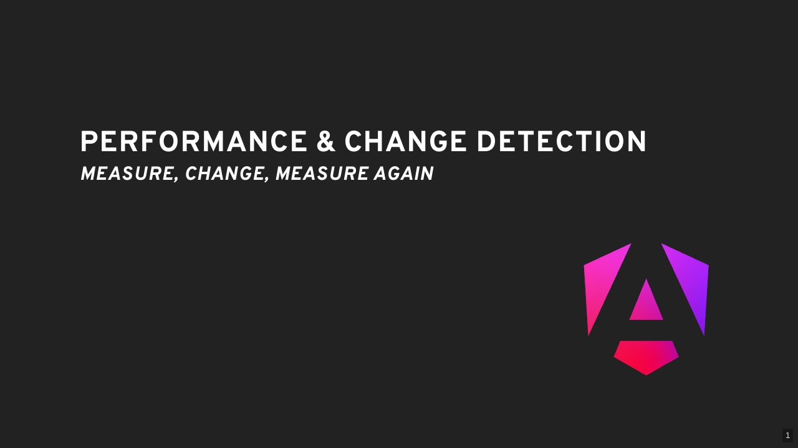

Speaker notes

> Performance & Change Detection: one day, four labs on the playground app.
> Ex 1 leave the zone, ex 2 zoneless and signals, ex 3 load less, ex 4 memory.
>
> Welcome. Today we make the playground app faster, and we only believe numbers.
> The app is slow in ways you can see in a profiler. In every lab you measure first, change one thing, and measure again to see the number move.
> Four labs: take the map out of the zone, go zoneless with signals, load less up front, and clean up what leaks. Each one ends with a slide called "In your app": what to try on Monday.
> Ask the room who has opened a profiler on their own app. That tells you how long to stay on the tools.

## 2. What does "slow" mean?

`what-slow-means.html` · type `reveal-list`

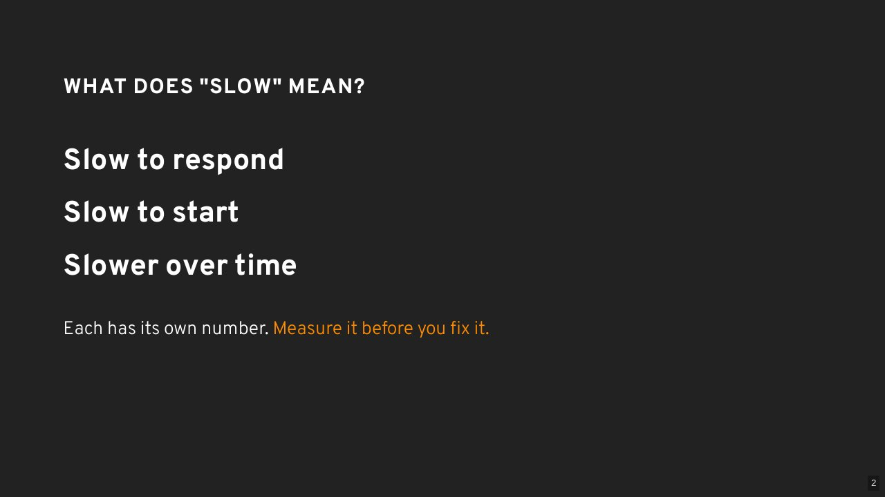

Speaker notes

> Three clicks, three kinds of slow, then the rule.
> Respond: Profiler bars in 5 s of mouse moves (labs 1, 2). Start: Initial total from npm run build (lab 3). Over time: objects counted in a heap snapshot (lab 4).
>
> When a user says the app is slow, ask which slow.
> Click. Slow to respond: you move the mouse or click, and the screen answers late. Usually Angular does too much work per event. We count bars in the Angular DevTools Profiler, labs 1 and 2.
> Click. Slow to start: the wait before you can use the app. JavaScript to download, parse and run. We read Initial total in the build output, lab 3.
> Click. Slower over time: fine when you opened it, heavy an hour later, because things were never cleaned up. We count objects in a heap snapshot, lab 4.
> Click. Each kind has its own number, and a fix for one does nothing for the others. That's the only rule today: measure, change exactly one thing, measure again the same way. Developers are bad at guessing where time goes, and a fix that does nothing still feels like progress.
> Ask the room: which of the three did your last "the app is slow" ticket mean?

## 3. Change detection in one minute

`change-detection-in-one-minute.html` · type `claim-image`

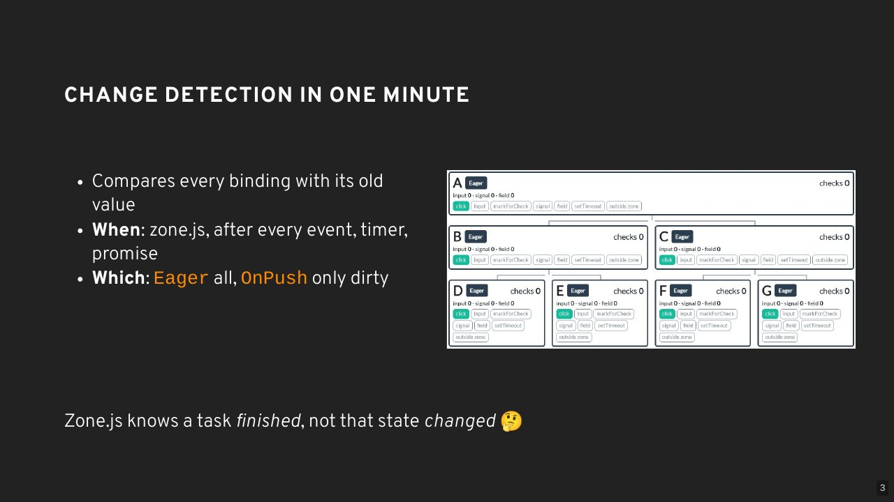

Speaker notes

> Before class: npm run start:no-hmr in demo/, open http://localhost:4201/performance/change-detection, press Reset counters.
> Demo: All Eager, click "click" on E: all seven nodes flash, checks 1 each. All OnPush, Reset, same click: only E, B, A flash (the screenshot, after two clicks).
> Credit: the demo is modelled on Matthieu Riegler's Angular change detection demo, https://jeanmeche.github.io/angular-change-detection/
>
> Change detection keeps the screen in sync with your data. After something happens, Angular walks the tree from the root and compares every binding with its old value.
> So the cost is easy to state: how many components are checked, times how many bindings they have, once per cycle. Two levers: how often does a cycle run, and how many components does each one check?
> When: in today's app, zone.js decides. It patches events, timers and promises, and runs a cycle after every one. It knows a task finished, not that anything changed. New apps since Angular 21 are zoneless, and that's exercise 2.
> Which: Eager is the old Default, renamed: checked every time the walk passes. OnPush: only when something marked it dirty.
> Switch to the demo. All Eager, Reset counters, click "click" on E. Every node flashes yellow, seven checks for one click on a leaf. Now All OnPush, Reset, the same click: only E, B and A, like the screenshot. Ask the room: why A and B, when nobody clicked them? They're on the path from E to the root.
> The demo is built on Matthieu Riegler's change detection demo from the Angular team, so the credit goes to him.

## 4. Exercise 1 - Getting started

`exercise-1-getting-started.html` · type `exercise-start`

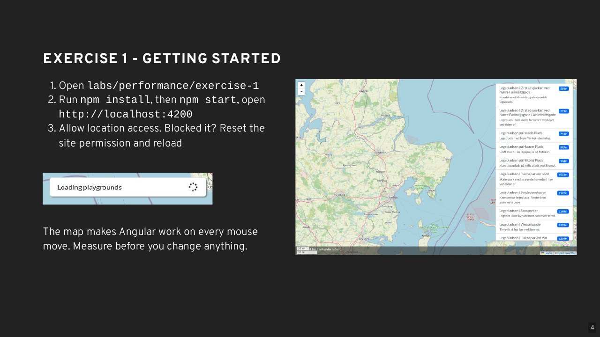

Speaker notes

> Angular DevTools installed? (pre-course requirement). labs/performance/exercise-1, npm install, npm start, http://localhost:4200.
> Location: allow it, the list waits. Blocked? "Loading playgrounds" forever, like the small picture: reset the site permission and reload.
> No Angular DevTools on a machine? Plan B is Chrome's Performance panel with the Angular track, two slides on.
>
> Time for exercise 1. Angular DevTools, the Chrome extension, was on the list of things to install before the course. Check that everyone has the Angular tab in DevTools now. Anyone who can't install extensions uses plan B, Chrome's own Performance panel, which I show in a moment.
> Go to labs/performance/exercise-1, npm install, npm start, open localhost:4200. The browser asks for your location: allow it, the playground list waits for it. If you blocked it by accident, the card says Loading playgrounds forever, like the small picture. Click the icon left of the address, reset the location permission and reload.
> The backend is slow on purpose, so you see a spinner for about three seconds. Then you get the map, the list and the footer counting seconds, like the screenshot.
> Ask the room: move the mouse over the map. Does it feel slow? It doesn't, on your laptop. That's why we measure.

## 5. Exercise 1 - Measure before

`exercise-1-measure-before.html` · type `exercise-step`

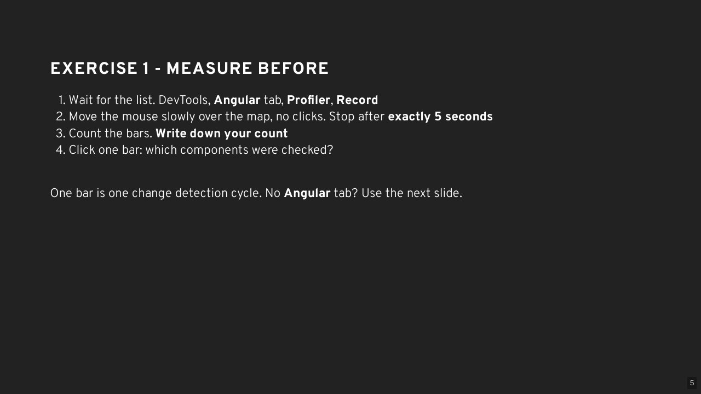

Speaker notes

> Record exactly 5 s, mouse moving slowly over the map, no clicks, Stop. Count the bars, write the count down, click one bar.
>
> Measure before. Wait until the list is there, open DevTools, the Angular tab, Profiler, press Record. Move the mouse slowly over the map, no clicks, no zoom, and stop after exactly five seconds. A fixed time is what makes before and after comparable.
> Every bar in the Profiler is one change detection cycle. Count them and write your number down. Then click one of the bars: the Profiler lists the components that were checked in that cycle and how long each took.
> Don't say a number yet. Let them count, then the next slide but one has ours.

## 6. Exercise 1 - Plan B: the Angular track in Chrome

`chrome-performance-angular-track.html` · type `claim-code`

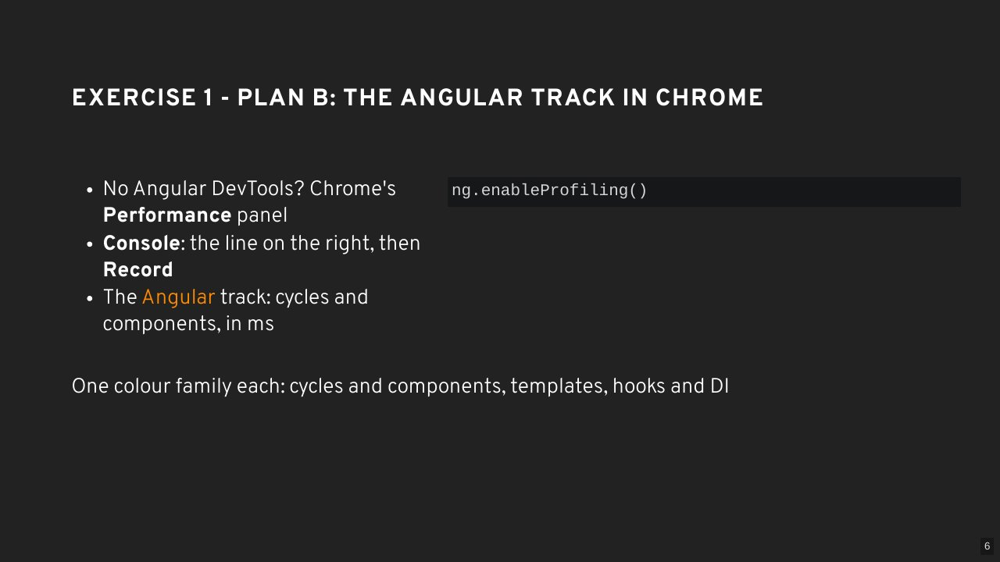

Speaker notes

> Plan B for anyone without Angular DevTools, and the view when you want milliseconds. Dev build (npm start).
> Console: ng.enableProfiling(). Performance, Record, use the app, Stop. Track "🅰️ Angular" next to Main.
> Colours, from Angular's source: "primary" family for change detection cycles and component names, "secondary" for template functions and host bindings, "tertiary" for lifecycle hooks, listeners and DI.
>
> The second tool lives in Chrome's own Performance panel, so it works without the extension. Angular writes its work into the timeline, but you switch it on yourself: type ng.enableProfiling() in the console of a dev build.
> Then record as usual. Next to the usual tracks there's an Angular track: each change detection cycle, and inside it the components that were checked, with their time in milliseconds.
> Click. Angular colours the entries by kind: one colour family for cycles and components, one for template code, one for lifecycle hooks, listeners and dependency injection. The exact colours depend on the DevTools theme, so read the label, not the colour.
> Which one to use? The Angular DevTools Profiler is simplest for counting cycles. The Performance panel is better when you want milliseconds next to everything else the browser does: layout, paint, long tasks. Our millisecond numbers today come from there.

## 7. Exercise 1 - What we measured

`exercise-1-measure-before-2.html` · type `exercise-result`

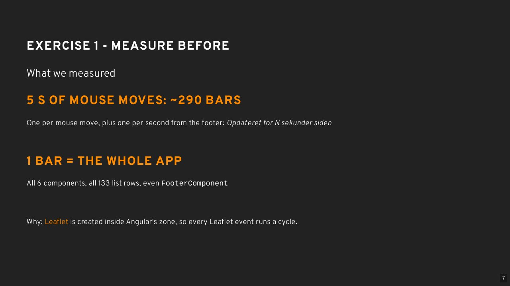

Speaker notes

> Click: ~300 bars (our runs: 298, 301, 300, 301). Click: one bar checked all 6 components and all 133 list rows. Click: why.
> 6 components, not 7: PlaygroundDetailComponent only exists on /legeplads/:id.
>
> In our runs, five seconds gave about 300 bars. Chrome sends roughly one mousemove per frame while the mouse moves, and every one is a cycle, plus five from the footer's one-second timer. Your number depends on your mouse and your screen, so compare with the one you wrote down.
> Click. One of those bars checked all six components on the page and all 133 rows in the sidebar, because a mouse moved over a map. Ask the room: the app has seven components, why six? The seventh is the detail page, and it only exists on /legeplads/:id.
> Ask the room: what on this page needs to know where the mouse is? Nothing. Click. Leaflet adds its mousemove, drag and zoom listeners when it creates the map, and we create it inside Angular's zone, so zone.js patches them and runs change detection after each one.

## 8. Exercise 1 - Running outside zone.js

`running-outside-zone-js.html` · type `claim-code`

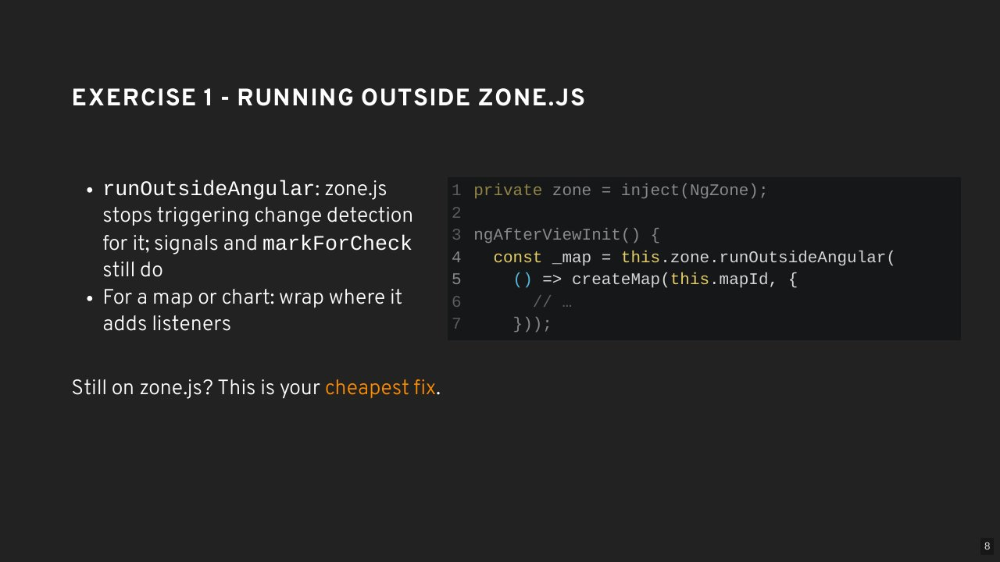

Speaker notes

> Demo: /performance/change-detection. All Eager, Reset, click setTimeout on B: every node flashes, checks 2 each (zone entry + timer). Reset, click "outside zone" on B: nothing flashes, B's field stays stale.
> Click through the highlights: the injected zone, then the wrapped createMap call. Click: the punchline.
>
> Here's the tool. NgZone.runOutsideAngular takes a function and runs it outside the zone. Anything it starts, event listeners and timers, isn't patched, so zone.js doesn't trigger change detection after them. Be precise: only zone.js stops. A signal you set in there, or a markForCheck, still schedules a check.
> Switch to the demo. All Eager, Reset counters, click setTimeout on B. Every node flashes, and the counters say two checks each: one for the click, one for the timer. Reset, click outside zone on B. Nothing flashes. B's field did change, but the screen still shows the old value. Ask the room: when will B show the new number? At the next cycle, whatever starts it.
> That's the catch. Fine for a map that draws its own DOM. If a template depends on something in there, set a signal.
> The code is exercise 1. The map is created inside runOutsideAngular, and the arrow function returns it, so const _map still works. Leaflet adds its listeners when the map is created, so wrapping creation is enough.
> Click. If your app at work still runs zone.js, this is the cheapest fix you'll find today: one wrapper, no refactoring. If it's already zoneless, you get this for free, and that's lab 2.

## 9. Exercise 1 - Leave the zone

`exercise-1-leave-the-zone.html` · type `exercise-step-code`

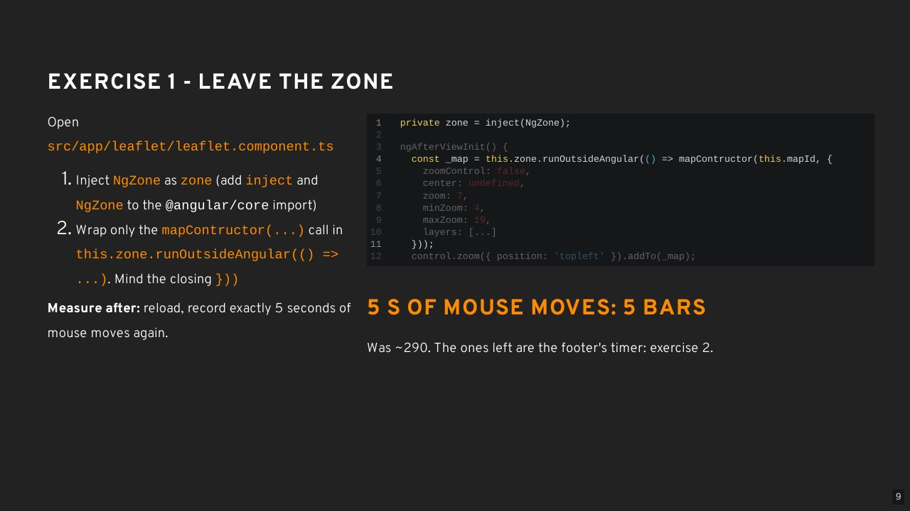

Speaker notes

> Inject NgZone, wrap createMap(...) only. Mind the closing })). Reload, record 5 s again, write it down.
>
> Now the fix. Open leaflet.component.ts. Inject NgZone into a field called zone, and add inject and NgZone to the import from @angular/core. In ngAfterViewInit wrap just the call that creates the map. It's one expression, so it becomes an arrow function that returns the map. Watch the closing: two parentheses after the options object.
> Measure after. Reload, record exactly five seconds of mouse moves again, and write the number next to the first one.

## 10. Exercise 1 - Measure after

`exercise-1-measure-after.html` · type `exercise-result`

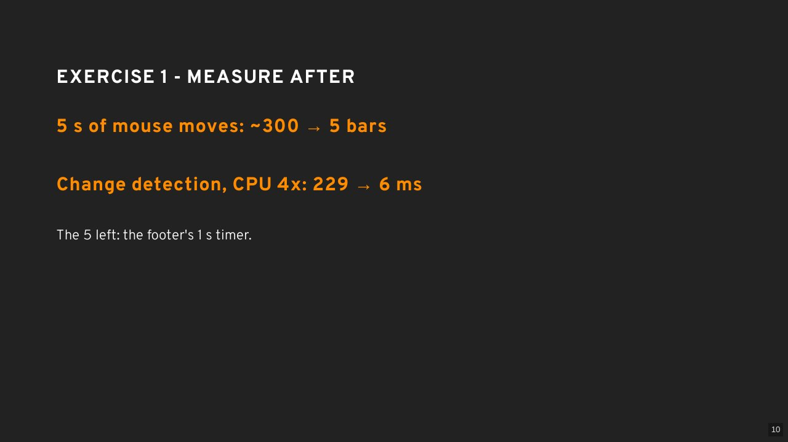

Speaker notes

> ~300 -> 5 bars (5, 5, 5 in our runs). Click: 229 -> 6 ms of change detection in those 5 s (median of 3, CPU 4x slowdown, Angular track timing).
> The 5 left are the footer timer, one per second.
>
> Five bars, where you had about 300. They're the footer's one-second timer, one per second, and that's exercise 2.
> Click. In milliseconds: with the CPU slowed down four times, like a mid-range phone, change detection took 229 ms of those five seconds before and 6 ms after. That's time the main thread didn't have for anything else.
> Ask the room: why is wrapping creation enough, when the mouse moves long after? Because Leaflet registers its listeners at creation. Created outside the zone, never patched.
> If someone asks: the zoom buttons are added after the wrapped call, so clicking them still runs a cycle. That's a click, not a stream. And clicking a playground in the list still gives a burst of bars: that's the bonus.

## 11. Exercise 1 - Bonus: the list click

`exercise-1-bonus-list-click.html` · type `exercise-step-code`

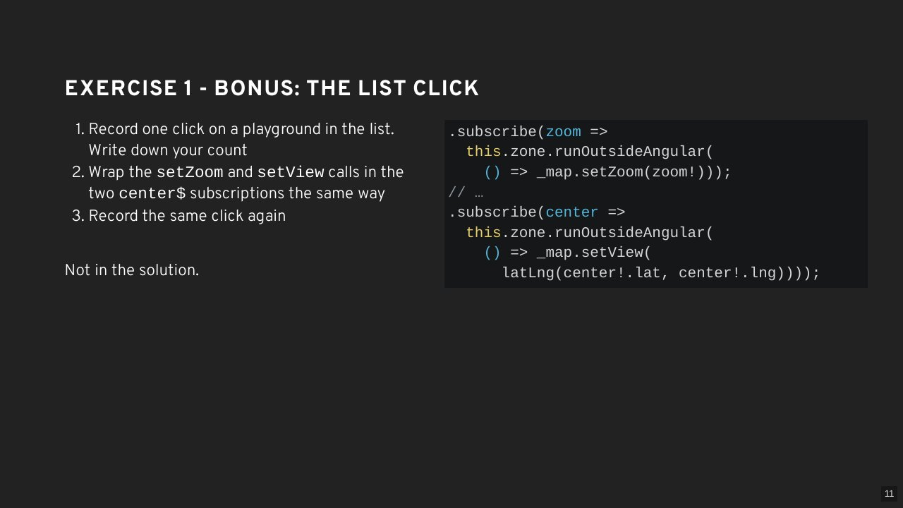

Speaker notes

> Bonus, not in the solution: exercise 2 fixes it for the whole app. Record one list click, wrap setZoom/setView in runOutsideAngular, record again.
>
> For the fast ones. Click a playground in the list and record it: you get a burst of bars, not one. The click itself is one cycle, but the two center$ subscriptions call setZoom and setView inside the zone, and Leaflet animates the pan from there: every animation frame is a patched task.
> Wrap those two calls in runOutsideAngular, the same trick, and record the same click again. Compare the two counts.
> It's not in the solution, on purpose: in exercise 2 we take zone.js out, and then this problem is gone for the whole app at once.

## 12. Exercise 1 - Bonus: try it, then revert

`exercise-1-bonus.html` · type `exercise-step-code`

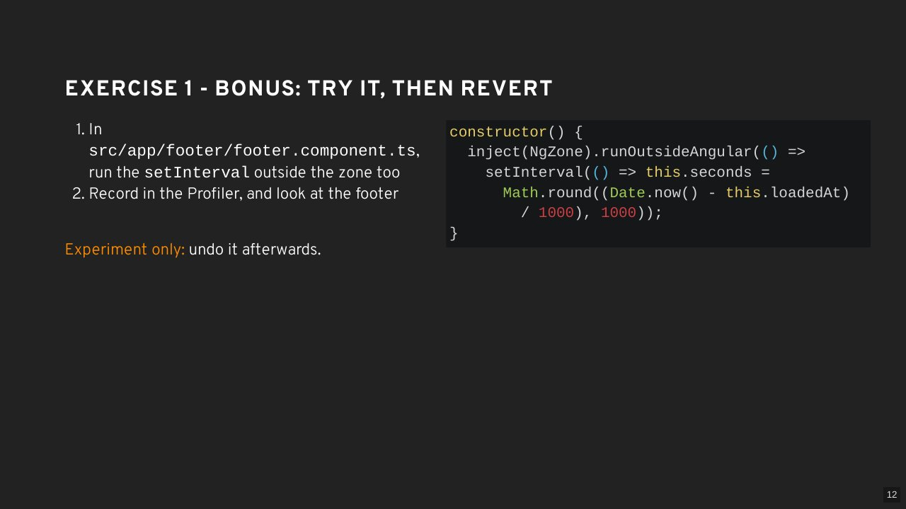

Speaker notes

> TRY AND REVERT. Not part of the solution. Footer interval outside the zone, record, look at the footer.
>
> A second bonus, and this one is a try and revert experiment. Do not keep this change.
> The footer counts seconds with a setInterval that writes a plain field. Wrap that interval in runOutsideAngular, the same trick as for the map. Then record in the Profiler and look at the page. Ask the room before the next slide: what do you expect?

## 13. Exercise 1 - Bonus: try it, then revert

`exercise-1-bonus-2.html` · type `exercise-result`

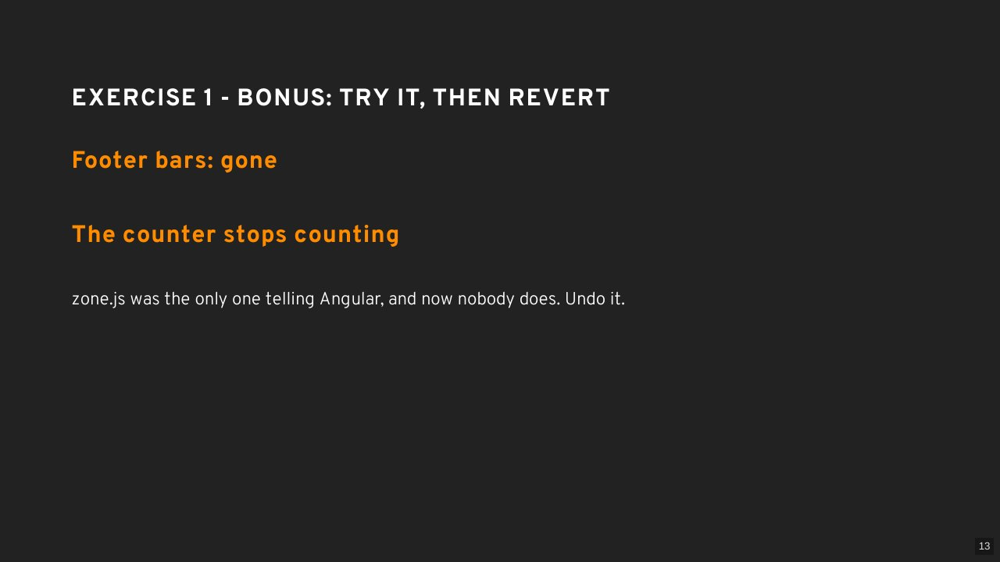

Speaker notes

> Bars gone, counter frozen (it only moves when something else runs a cycle, like a click on a playground).
> Point: zone.js was the trigger. Plain field + no zone = no update. Lead-in to exercise 2. Revert before the break.
>
> Look at the profiler: the footer's bars are gone. Great? Click. Look at the page. The counter has stopped. The field still changes every second, but the screen doesn't, because nothing tells Angular to check the footer. It only moves if something else triggers a cycle, for example a click on a playground.
> Click. That's the whole lesson: zone.js was the only one telling Angular, and now nobody does.
> Now undo it, so you start the break with the working footer. After the break we remove zone.js for the whole app, the same thing happens everywhere, and then we fix it the right way.

## 14. Exercise 1 - In your app

`exercise-1-in-your-app.html` · type `exercise-step`

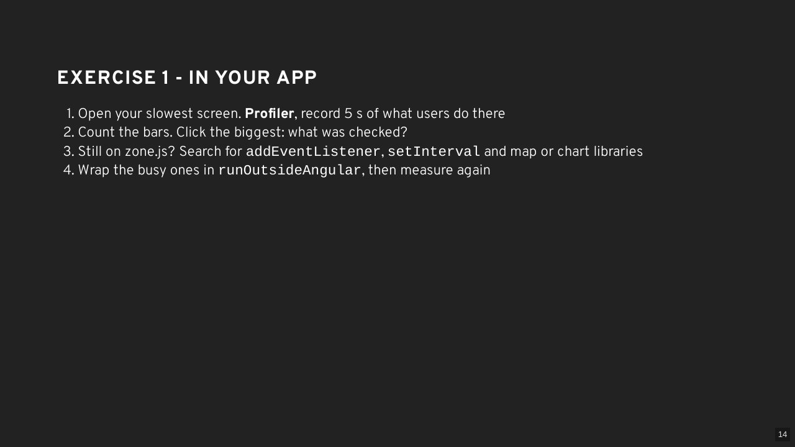

Speaker notes

> Monday homework for lab 1: Profiler on their own slowest screen, then grep for listeners and timers.
>
> Here's exercise 1 in your own app. Open the screen your users call slow, record five seconds of what they normally do there, and count the bars. Click the biggest bar and look at what was checked.
> If the app still runs zone.js, look for the things that fire often: addEventListener, setInterval, and third-party widgets like maps, charts and editors that add their own listeners. Wrap where they're created in runOutsideAngular, and measure again.
> Ask the room: who has a map, a chart or a drag-and-drop library in their app?

## 15. From zone.js to zoneless

`from-zone-js-to-zoneless.html` · type `claim-code`

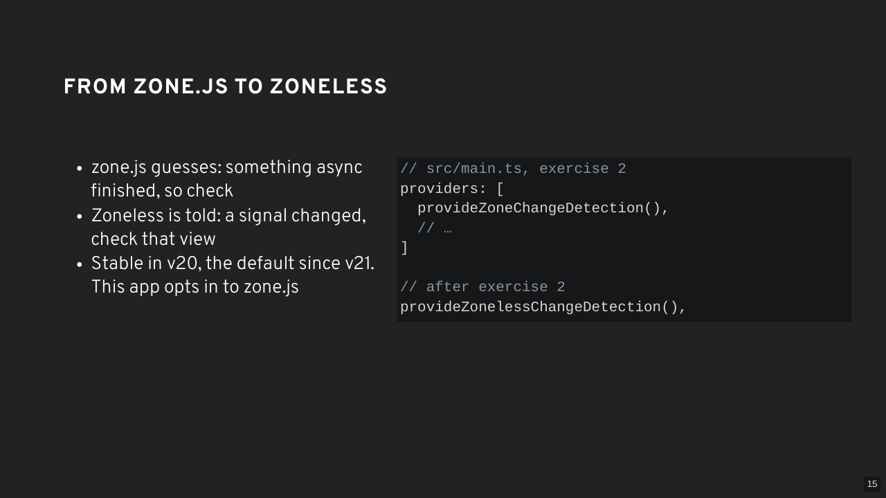

Speaker notes

> Recap from signals. Guesses vs is told. Versions: zoneless stable in v20, default in v21.
> runOutsideAngular from exercise 1 can stay: it still compiles and does no harm zoneless.
>
> You saw this in the signals course, so one minute. zone.js guesses: an event or a timer finished, so maybe something changed, check. Zoneless is told: a signal a template reads changed, so refresh that view.
> Zoneless became stable in Angular 20 and is the default for new apps since 21: they write nothing in main.ts. Our app still says provideZoneChangeDetection. In exercise 2 you swap it for provideZonelessChangeDetection and take zone.js out of the build.
> Your runOutsideAngular from exercise 1 can stay. Ask the room: what will happen to the footer counter when the zone is gone? Hold that thought, next slide.

## 16. Zoneless: what schedules change detection?

`what-schedules-change-detection.html` · type `reveal-list`

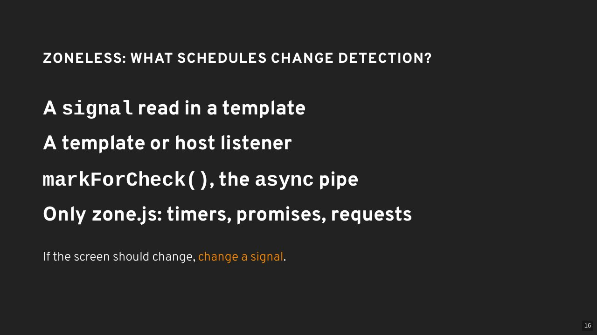

Speaker notes

> Clicks 1-3: the three that schedule a check, with or without zone.js. Click 4: the ones only zone.js schedules (setTimeout, setInterval, a promise or request finishing). Click: the rule.
> Demo: /performance/change-detection. All OnPush, signal on B: only B flashes. setTimeout on B: nothing flashes, B keeps field 0; click "click" on B: A and B flash, field jumps to 1.
>
> Here's the list to keep in your head. Click, click, click. These three schedule a check, with or without zone.js: a signal read in a template, a listener in a template, markForCheck, which the async pipe calls for you.
> Click. Only zone.js: timers, promises, requests. These used to work only because the zone ran a cycle after every timer and every finished request. Zoneless, they schedule nothing. And assigning a plain field never scheduled anything, the next cycle just happened to pick it up. The footer's setInterval writes a plain field, so ask the room: what happens to the footer counter in exercise 2? It freezes.
> Switch to the demo. All OnPush, Reset. Click signal on B: only B flashes. Click setTimeout on B: nothing flashes, B still shows field 0. Click "click" on B: A and B flash, and now the field jumps to 1. The value was there all along, nobody asked Angular to look.
> Be precise about what you just saw: the demo app still has zone.js. The timer did start a cycle, and OnPush skipped B because nothing marked it. Zoneless, there wouldn't even be a cycle.
> Click. The rule of thumb: if the screen should change, change a signal.

## 17. OnPush is the default (v22)

`onpush-is-the-default.html` · type `claim-code`

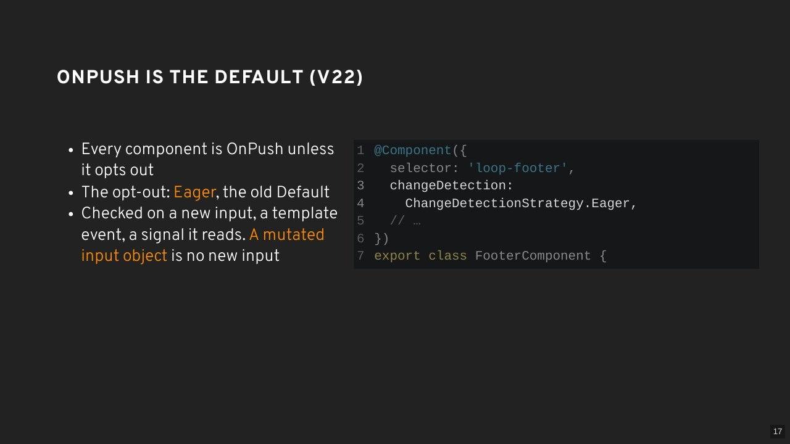

Speaker notes

> Recap from signals. Eager = the old Default: checked whenever the walk reaches it. ng update to 22 adds Eager to every component.
> Mutated input object: same reference, so OnPush sees no change. That's an OnPush rule, with or without zone.js.
>
> Since Angular 22 every component is OnPush unless it says otherwise. The old default is now called Eager, and Default is a deprecated alias for it.
> Eager means: check me every time change detection walks past. That's how the footer's plain field works under zone.js: the zone runs a cycle every second, the footer is checked, the new number shows. ng update adds Eager to every component so nothing changes behaviour, and our app looks exactly like that.
> An OnPush component is checked when an input gets a new value, an event fires in its template, or a signal its template reads changes.
> The catch with inputs: a new value means a new reference. Push to an array that a child gets as an input, and the reference is the same, so OnPush sees nothing and the child stays stale. Pass a new array or object, or make it a signal. That's OnPush, it has nothing to do with zone.js.
> In exercise 2 you make the counter a signal, then the Eager lines can go. Ask the room: in your own app after ng update to 22, how many Eager lines are there? That's your to-do list.

## 18. On Angular 15–19?

`on-angular-15-to-19.html` · type `reveal-list`

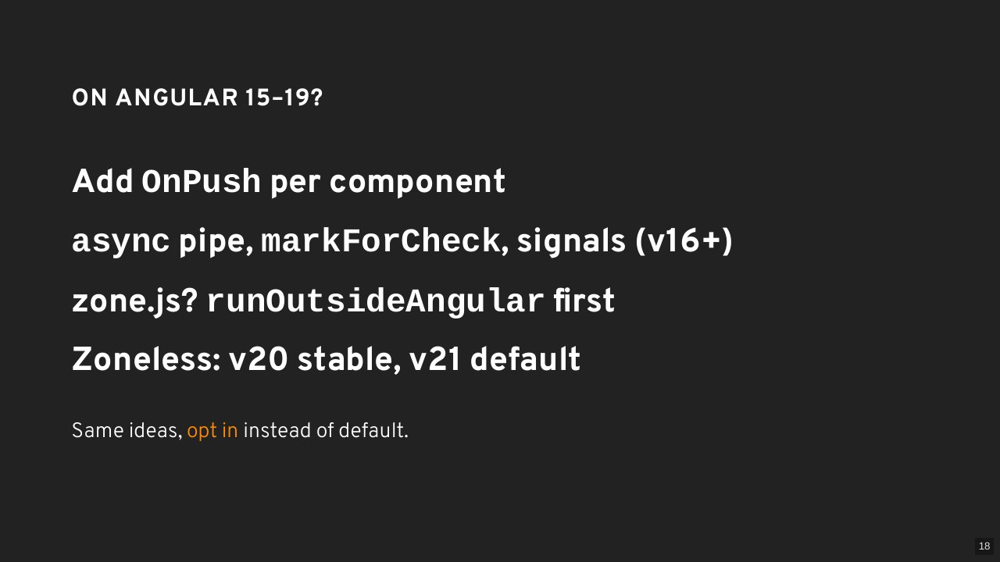

Speaker notes

> For everyone not on 22 yet. Before v22 OnPush was opt-in per component. Signals from v16 (stable in v17). Zoneless stable in v20, default for new apps in v21.
>
> Not everyone here is on Angular 22 at work, so here's today in older versions.
> Click. OnPush exists in every version, but before 22 you opt in, one component at a time: changeDetection: ChangeDetectionStrategy.OnPush. Start with the leaves that render a lot, like list rows.
> Click. Then the component has to be told when to update: the async pipe, markForCheck, and from Angular 16 signals in the template.
> Click. Your app runs zone.js, so runOutsideAngular from exercise 1 is the cheapest win you have: it works in every version.
> Click. Zoneless needs Angular 20 to be stable, and 21 makes it the default for new apps. If you're on 19, it's still experimental there.
> Click. Same ideas as today, you just opt in instead of getting them by default. Ask the room: which version is your app on?

## 19. Lists: track and computed

`lists-track-and-computed.html` · type `claim-code`

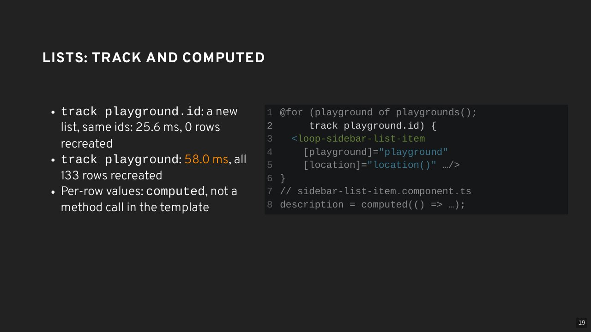

Speaker notes

> Not a lab: the app already does it right. Numbers from a copy of step-3, dev build, CPU 4x: the server list (new objects, same ids) replaces the cached list.
> track playground.id: 25.6 ms median, 0 rows created. track playground (object identity): 58.0 ms median, 133 rows destroyed + 133 created.
>
> One slide on lists, because every app has one. The list in our app is already done right, so this is to check in yours.
> @for needs a track expression. It tells Angular which row is which when the list changes. The app tracks by id. When the server answer replaces the cached list, every object is new but the ids are the same, so Angular keeps all 133 rows and only updates bindings: 25.6 milliseconds with the CPU slowed down.
> Track the object itself, and every new object is a new row: 133 rows destroyed and 133 created, 58 milliseconds. Ask the room: what does your API return on a refresh, the same objects or new ones?
> Second rule: anything a row derives, put it in a computed, like description and distance here. A method call in a template runs on every check of that row; a computed runs only when what it reads changes.

## 20. Exercise 2 - Measure before

`exercise-2-measure-before.html` · type `exercise-step`

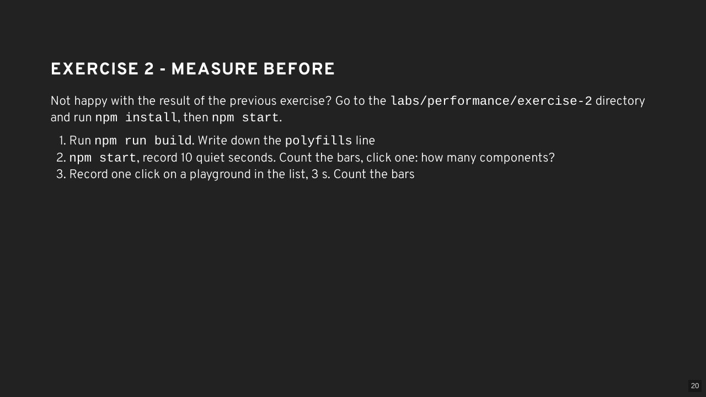

Speaker notes

> labs/performance/exercise-2. Build: write down polyfills. Profiler: 10 quiet s, then one list click (3 s). Write everything down, no numbers from me yet.
>
> Exercise 2 starts with a measurement, as always. If your exercise 1 isn't working, go to labs/performance/exercise-2 and run npm install.
> Run npm run build and write down the polyfills line, raw and transfer. Then npm start and record ten quiet seconds in the Profiler: count the bars and click one to see how many components it checked. Then record one click on a playground in the list, about three seconds, and count again.
> Three numbers on your paper before we touch anything.

## 21. Exercise 2 - Go zoneless

`exercise-2-go-zoneless.html` · type `exercise-step-code`

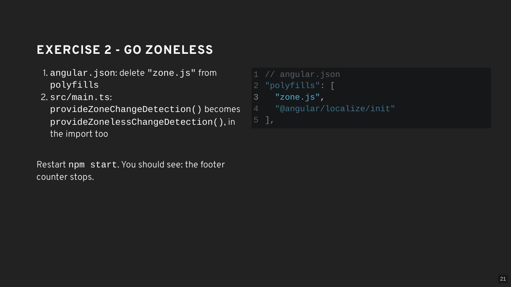

Speaker notes

> Change: zone.js out of polyfills, provideZonelessChangeDetection in main.ts. Expect: the counter freezes.
>
> Now the change. In angular.json delete the zone.js line from polyfills. In main.ts swap provideZoneChangeDetection for provideZonelessChangeDetection, in the import too. Since v21 zoneless is the default, so deleting the line would do the same; the solution keeps provideZonelessChangeDetection so the next reader sees the choice. Leave runOutsideAngular from exercise 1 where it is.
> Restart and look at the footer. Ask the room: why did the counter stop? A timer writes a plain field, and nothing tells Angular. setInterval is on the "Only zone.js" list. Next slide fixes it.

## 22. Exercise 2 - Fix the footer with a signal

`exercise-2-fix-the-footer.html` · type `exercise-step-code`

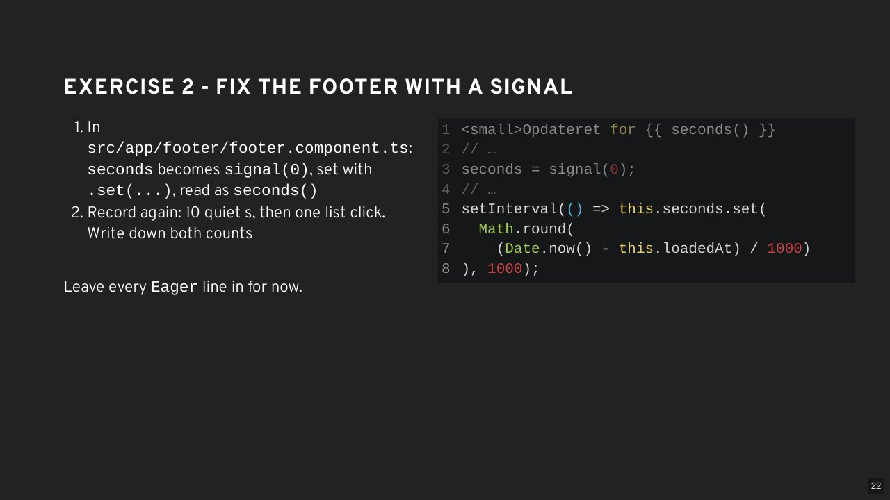

Speaker notes

> footer: signal(0), .set(), seconds() in the template; signal in the import. Eager stays everywhere for now. Then measure: 10 quiet s, one list click.
>
> The fix is small. Make seconds a signal, set it in the interval, call it in the template, and add signal to the import. Step through the highlights: the template call, the signal, the set.
> Ask the room: why does the counter work without markForCheck? The template reads the signal. When the interval sets a new value, Angular marks that view and schedules a cycle.
> Leave the Eager lines in for now, so we can see what zoneless does on its own. Record ten quiet seconds and one list click again, and write both down.

## 23. Exercise 2 - What we measured

`exercise-2-zoneless-result.html` · type `exercise-result`

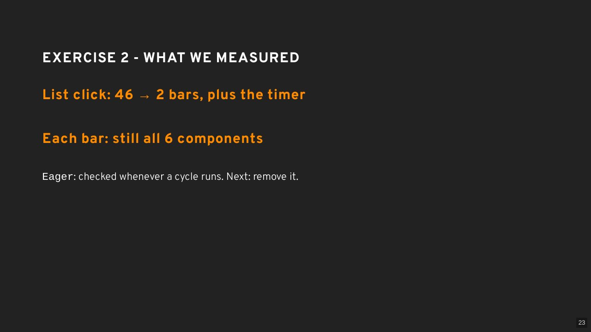

Speaker notes

> Before (zone.js): one list click = 46 bars in 3 s (46, 47, 46). Zoneless + signal, Eager kept: 5 bars in 3 s = 2 from the click + 3 timer bars, every bar still 6 components / 133 rows. 10 quiet s: still 10 bars, each 6 / 133.
>
> Click. The list click. Under zone.js it gave us 46 bars, because Leaflet's pan animation ran inside the zone. Zoneless, the click makes two bars, plus the footer's one per second. Nobody wrapped anything: there is no zone left to patch the animation.
> Click. But click any bar: it still checks all six components and all 133 rows, the footer tick too. Ask the room: why? Every component still says Eager, and Eager means "check me whenever a cycle runs".
> Click. So zoneless decides when a cycle runs. Eager versus OnPush decides how much of the tree it checks. Next step: the Eager lines go.

## 24. Exercise 2 - Remove Eager

`exercise-2-remove-eager.html` · type `exercise-step`

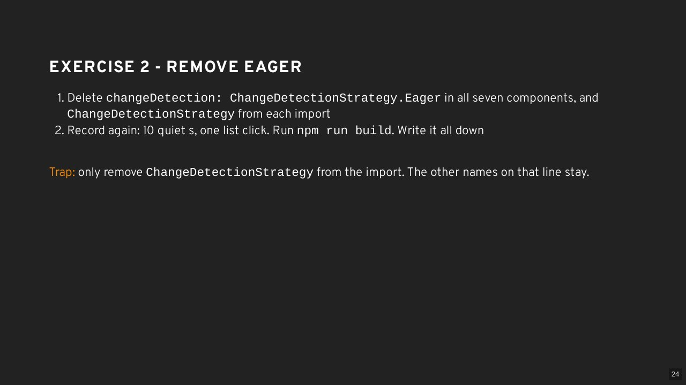

Speaker notes

> Seven files: app, home, sidebar, sidebar-list-item, playground-detail, leaflet, footer. Then the same recordings, plus npm run build.
>
> Now the Eager line goes, in all seven components: app, home, sidebar, list item, detail page, the Leaflet wrapper and the footer. Search for ChangeDetectionStrategy.Eager to find them. Only remove ChangeDetectionStrategy from the import, the other names on that line stay.
> Then measure the same way: ten quiet seconds, one click in the list, and build again for the polyfills line.

## 25. Exercise 2 - Measure after

`exercise-2-measure-after.html` · type `exercise-result`

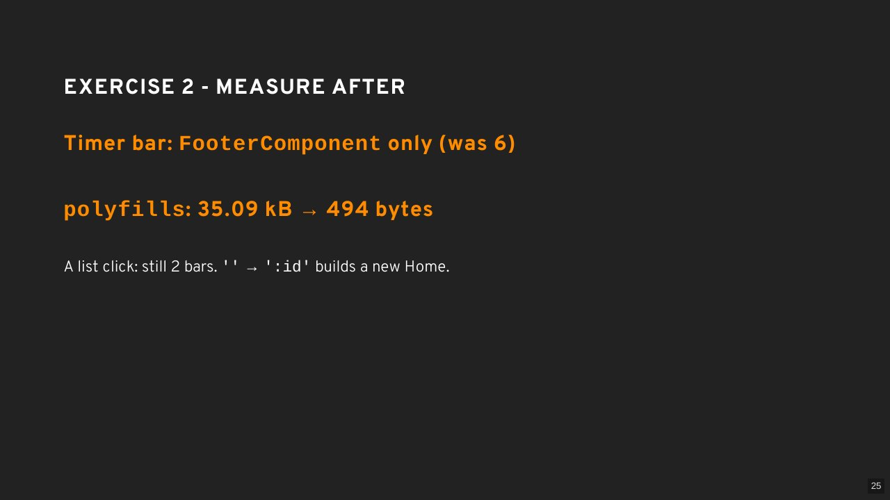

Speaker notes

> Click: timer bar = FooterComponent only (1 component, 0 rows), was 6 components / 133 rows. Click: polyfills 35.09 kB -> 494 bytes (Initial total 1.81 MB -> 1.77 MB).
> List click: 2 bars + timer bars. First: 6 components / 133 rows (new Home). Second: 5 components. A second click ':id' -> ':id' reuses Home: 1 bar, 2 rows.
>
> Click. Quiet: still one bar per second, because the number really does change every second. But click the bar: only FooterComponent. Before, that tick checked all six components and 133 rows.
> Click. And the build: polyfills from 35 kilobytes to 494 bytes. main is practically the same, so the saving is zone.js itself.
> Click. The list click is still two bars, and the first one checks everything. That's not the signals failing. Look at app.routes.ts: the empty path and ':id' are two route entries that both show HomeComponent. Going from one to the other, the router destroys Home and builds a new one, and a new Home renders all 133 rows. Ask the room: what happens on a second click, from one playground to another? Same route entry, so Home is reused, and that bar checks 2 rows: the one you left and the one you picked.

## 26. Exercise 2 - In your app

`exercise-2-in-your-app.html` · type `exercise-step`

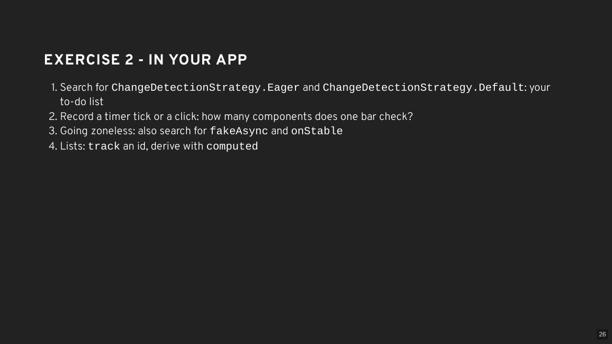

Speaker notes

> Monday homework for lab 2: grep for Eager/Default, profile one bar, check fakeAsync/onStable before going zoneless.
>
> Exercise 2 in your own app. Search the code for ChangeDetectionStrategy.Eager and Default. If you ran ng update to 22, every component has one: that's the list of components to move to signals and OnPush.
> Then record one timer tick or one click and look at what a single bar checks. If it's the whole tree, you've found your lever.
> Before you go zoneless, search for fakeAsync in the tests and onStable in the code: those depend on zone.js.
> And while you're in the templates, check your @for track expressions and any method calls in bindings.

## 27. What ends up in main?

`what-ends-up-in-main.html` · type `claim-code`

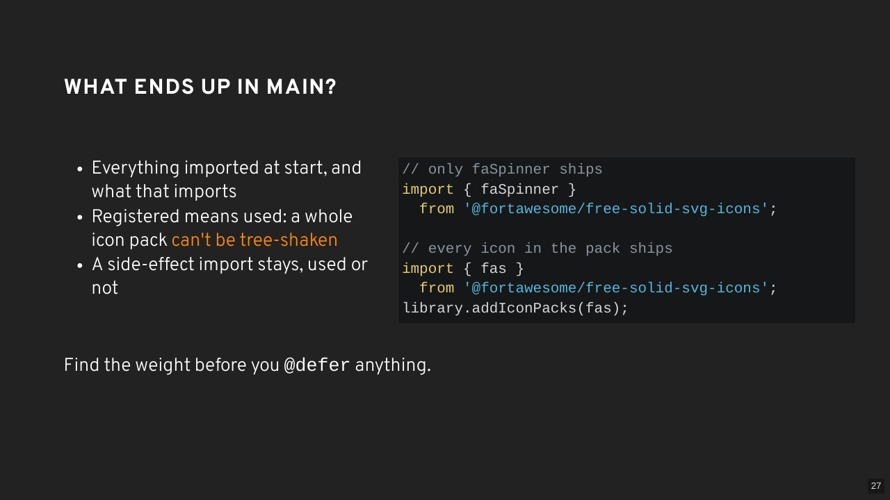

Speaker notes

> Tree-shaking keeps what's used. A registered pack is "used": every icon in it ships. Side-effect imports (import 'x') always stay.
> Exercise 3 opens with the esbuild analyzer on our main.
>
> The bundler only keeps code that something uses. That's tree-shaking. Import one icon by name and use it: one icon ships.
> The catch is what counts as "used". Hand a whole pack to a function, like addIconPacks, and every icon in that pack is used as far as the bundler can tell. It has no idea which ones your templates will ask for at runtime.
> Same with a side-effect import, import 'some-lib' with no names: the bundler has to keep it, because running it is the point.
> Click. So before you start splitting things with @defer, find out what's actually heavy. That's the first step of exercise 3. Ask the room: who knows what's in their own main bundle?

## 28. @defer and its triggers

`defer-triggers.html` · type `claim-code`

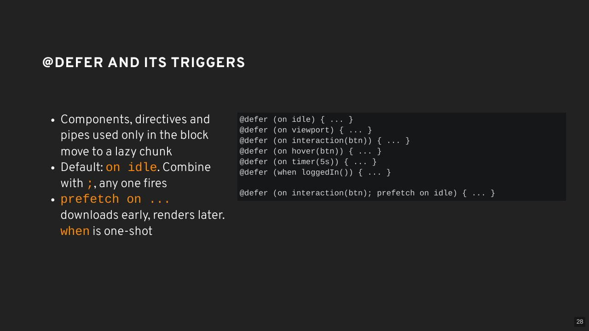

Speaker notes

> Demo: /performance/defer (demo on npm run start:no-hmr). Network, filter JS, reload: idle + prefetch chunks at once, timer at 3 s; hover "Hover me": hover-loaded chunk. Click "Downloaded already. Click me": renders, no new request.
> Then: throttle to Slow 4G, reload, click "Click me": "Loading ..." for about a second. Set throttling back to No throttling.
> viewChild(LeafletComponent) in Home on top of the defer: no leaflet chunk (measured on a copy of the exercise 3 start).
>
> @defer is lazy loading for part of a template. Everything inside the block that's only used there, components, directives, pipes, goes into its own chunk and is fetched when the trigger fires.
> Let me show you. Network tab, filter JS, reload. The idle card and the prefetch chunk come in right away, the timer card three seconds later. Ask the room: what happens when I hover "Hover me"? A new request. Now "Downloaded already. Click me": it renders, no new request. That's prefetch: download early, show later.
> The placeholder: what the user sees until the trigger fires. Give it the size of the content, or the page jumps. In the exercise the map placeholder is an empty full-size div. On viewport, hover and interaction without a reference watch the placeholder, so it needs exactly one root element.
> Throttle to Slow 4G, reload, click "Click me": the loading block shows for about a second. Then set throttling back to No throttling, or the rest of the demo crawls.
> Click through the trap: if anything outside the block uses the component, even a viewChild of it, it stays eager and there's no chunk. The build won't warn you; look for the chunk in the lazy table.

## 29. Exercise 3 - Measure the build

`exercise-3-getting-started.html` · type `exercise-step`

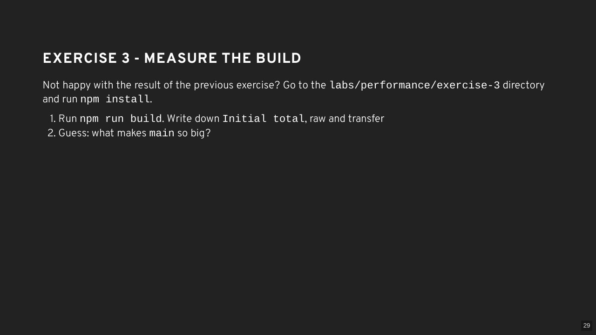

Speaker notes

> labs/performance/exercise-3, npm install. npm run build: write down Initial total, both numbers. Everyone writes a guess for what's in main.
>
> New exercise, and this one is about the first download. If exercise 2 isn't working, go to labs/performance/exercise-3 and npm install.
> Before you touch any code, npm run build. Find the line Initial total and write down both numbers, raw and estimated transfer. Raw is the file on disk, transfer is what goes over the wire after compression. That's your before.
> Then a guess on paper: what makes main so big? Next slide, we stop guessing.

## 30. Exercise 3 - What is in main?

`exercise-3-whats-in-main.html` · type `exercise-step-image`

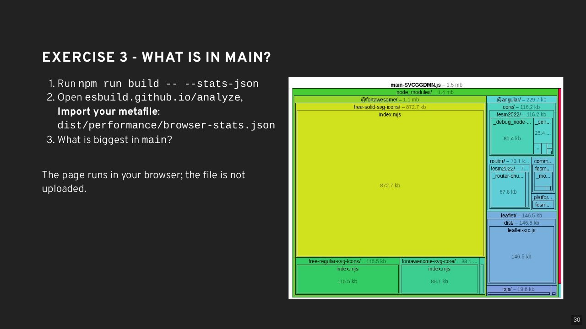

Speaker notes

> npm run build -- --stats-json. Analyzer: https://esbuild.github.io/analyze/, "Import your metafile...", dist/performance/browser-stats.json.
> Expect: Initial total 1.77 MB / 383.17 kB; main 1.5 mb, @fortawesome 1.1 mb of it (free-solid 872.7 kb, free-regular 115.5 kb, svg-core 88.1 kb), @angular 229.7 kb, leaflet 146.5 kb. Analyzer units are KiB.
>
> Build again with the stats flag: npm run build, two dashes, --stats-json.
> Then open the esbuild analyzer page. It runs in your browser, nothing is uploaded. Import your metafile, pick browser-stats.json in dist/performance. Click into main.
> Ask the room: who expected the map to be the big one? Leaflet is a thin strip on the right. The big yellow block is FontAwesome's solid icon pack, and below it the regular pack. The app shows exactly one icon: the spinner.
> Keep that picture in mind. The next four slides are four changes. Make them one at a time, build after each, write down Initial total each time.

## 31. Exercise 3 - Lazy detail route

`exercise-3-lazy-route.html` · type `exercise-step-code`

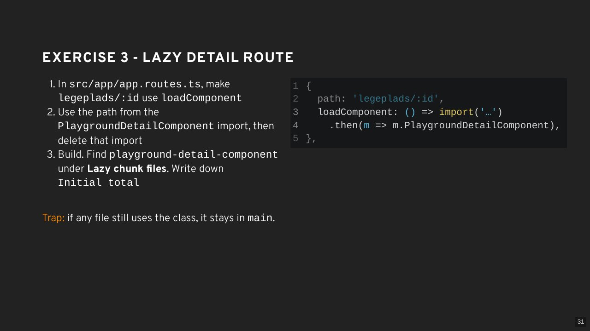

Speaker notes

> Change 1: app.routes.ts. The import() path is the full 'src/app/playground-detail/playground-detail.component' from the static import line, which then goes. Lazy table: playground-detail-component, about 1 kB.
>
> One change per slide, build after each.
> The detail route. In app.routes.ts, replace component with loadComponent and an import(). The path in the import() is the same string as in the import line at the top, src/app/playground-detail/playground-detail.component, so copy it from there and then delete that line. Build, and a second table shows up: lazy chunk files, with playground-detail-component in it. About one kilobyte. Small, but the table is the proof it worked. If anything still uses the class the normal way, there's no chunk.
> Ask the room after the build: did Initial total move?

## 32. Exercise 3 - Defer the map

`exercise-3-defer-map.html` · type `exercise-step-code`

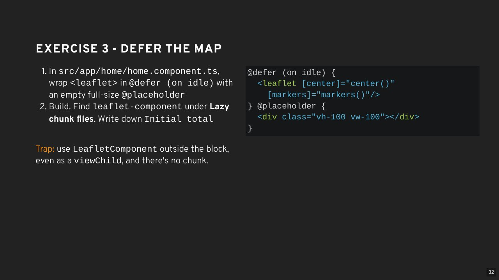

Speaker notes

> Change 2: home.component.ts, @defer (on idle) around leaflet, placeholder an empty vh-100 vw-100 div. Lazy table: leaflet-component, about 155 kB.
>
> The map. In home.component.ts, wrap the leaflet element in @defer on idle, and give it a placeholder: an empty div with vh-100 vw-100, so the page doesn't jump. Build again: a leaflet-component chunk of about 155 kilobytes.
> The trap: if anything in Home touches LeafletComponent outside the block, a viewChild for example, it stays eager and you get no chunk at all. Look for the chunk in the lazy table every time.
> Ask the room: the map now paints later than the list. Is that a problem? We'll measure that after the exercise.

## 33. Exercise 3 - Defer the footer, then revert

`exercise-3-defer-footer.html` · type `exercise-step-code`

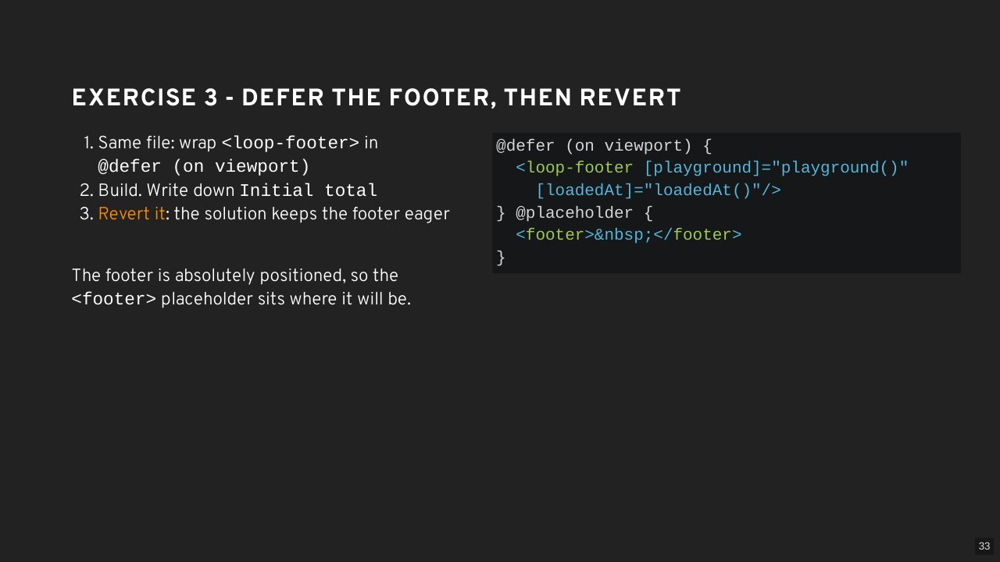

Speaker notes

> Change 3: try, measure, revert. @defer (on viewport) around loop-footer, placeholder <footer>&nbsp;</footer> (absolutely positioned like the real footer, so it takes its place at the bottom and is in view at once).
> Expect Initial total to go UP (1.62 -> 1.64 MB on top of the map). Why: on the results slide. Then revert.
>
> The footer. Same file, wrap loop-footer in @defer on viewport. The placeholder is an empty footer element with a non-breaking space. Our footer is absolutely positioned at the bottom of the screen, so the placeholder gets the same styling and sits exactly where the real footer will appear.
> Build and write the number down. Ask the room: did it go down? Then revert it, the solution keeps the footer eager. We'll see why on the results slide.

## 34. Exercise 3 - Register one icon

`exercise-3-one-icon.html` · type `exercise-step-code`

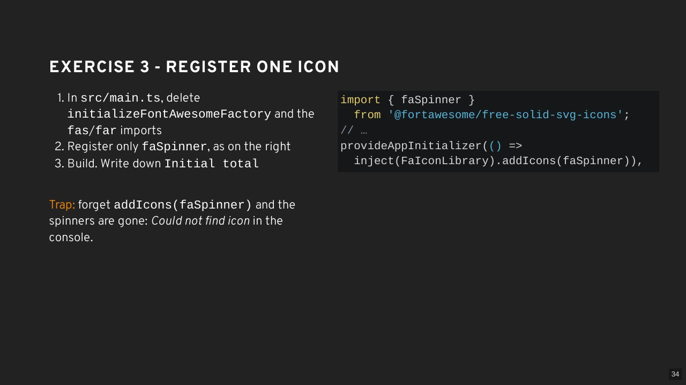

Speaker notes

> Change 4: main.ts. Delete initializeFontAwesomeFactory and the fas/far imports; provideAppInitializer(() => inject(FaIconLibrary).addIcons(faSpinner)).
> Forget addIcons: no spinner, console "Could not find icon with iconName=spinner and prefix=fas in the icon library."
>
> The icons, the thing the analyzer showed you. Open main.ts. The app registers every icon in two FontAwesome packs, solid and regular, through initializeFontAwesomeFactory. The app shows one: the spinner. So delete the factory and the two pack imports, import faSpinner, and in provideAppInitializer call addIcons with just that one.
> If you remove the packs and forget addIcons, the spinners disappear and the console tells you it can't find the spinner icon.
> Build, write the number down. Then the next slide: watch the chunks load.

## 35. Exercise 3 - Watch the chunks load

`exercise-3-see-it-load.html` · type `exercise-step-image`

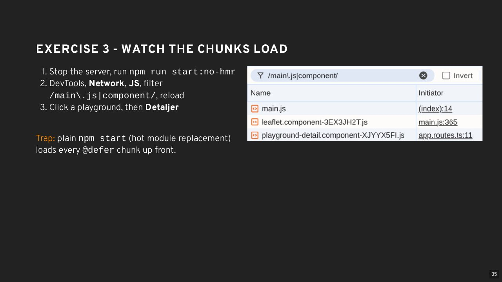

Speaker notes

> npm run start:no-hmr. Network, JS, filter box /main\.js|component/ (slashes included: a regex), reload. leaflet.component right after main (initiator main.js). Detaljer: playground-detail.component (initiator app.routes.ts).
>
> The build table told us the chunks exist. Now we watch them load.
> Stop the dev server and start it with npm run start:no-hmr. Hot module replacement loads every defer chunk up front, so with plain npm start the Network tab shows nothing interesting and you'd think defer is broken.
> Network tab, JS. The dev server serves a lot of small vendor files, so type /main\.js|component/ in the filter box, slashes included: that's a regular expression. Reload.
> Right after main you see leaflet.component, started by main.js: on idle fires fast on an idle laptop. Now click a playground and then Detaljer. Only then does playground-detail.component show up, and its initiator is app.routes.ts. That's the lazy route.
> Ask the room: on a phone on a slow network, which of those would you rather have the user wait for?

## 36. Exercise 3 - What did you measure?

`exercise-3-what-we-measured.html` · type `exercise-result`

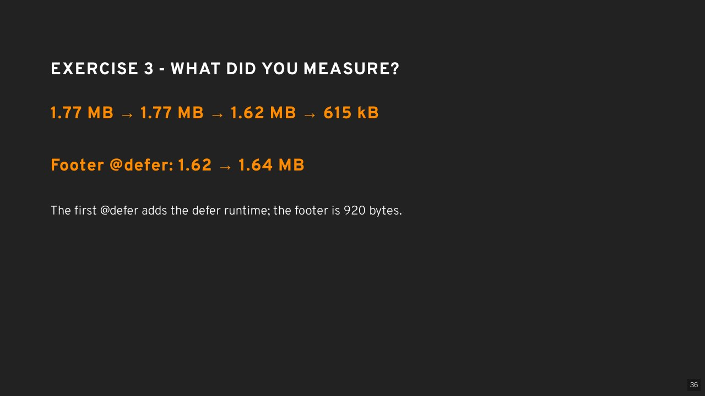

Speaker notes

> Raw Initial total, cumulative in slide order: start 1.77 MB / 383.17 kB, + route 1.77 MB / 383.58 kB, + map 1.62 MB / 346.92 kB, + icons (footer reverted) 615.00 kB / 125.46 kB. The solution (with the hidden Om appen bonus): 620.49 kB / 123.67 kB.
> Footer on top of route + map: 1.62 -> 1.64 MB (1,639.49 kB / 347.37 kB). Alone on the start: 1.77 -> 1.78 MB, +7,678 B: defer runtime + viewport trigger in, footer (920 B) out.
>
> Let's compare. Click. Your numbers, each build on top of the last: the lazy route barely moves it, the map takes it from 1.77 to 1.62 megabytes, and the icons take it from 1.62 megabytes to 615 kilobytes. Ask the room: who guessed the icons before the analyzer?
> Click. And the footer. It made Initial total go up. The first @defer in an app pulls in Angular's defer runtime and, for on viewport, the IntersectionObserver trigger. The footer component that moves out is 920 bytes. So you pay more than you save, and on top of that the footer is in view from the first frame, so the chunk is fetched straight away.
> Click. That's why the solution reverts it. Defer what's heavy and below the fold or behind a click, not what's small and in view. The solution, with the four changes minus the footer, is 620 kilobytes.

## 37. Exercise 3 - On a slow phone

`exercise-3-cold-load.html` · type `exercise-result`

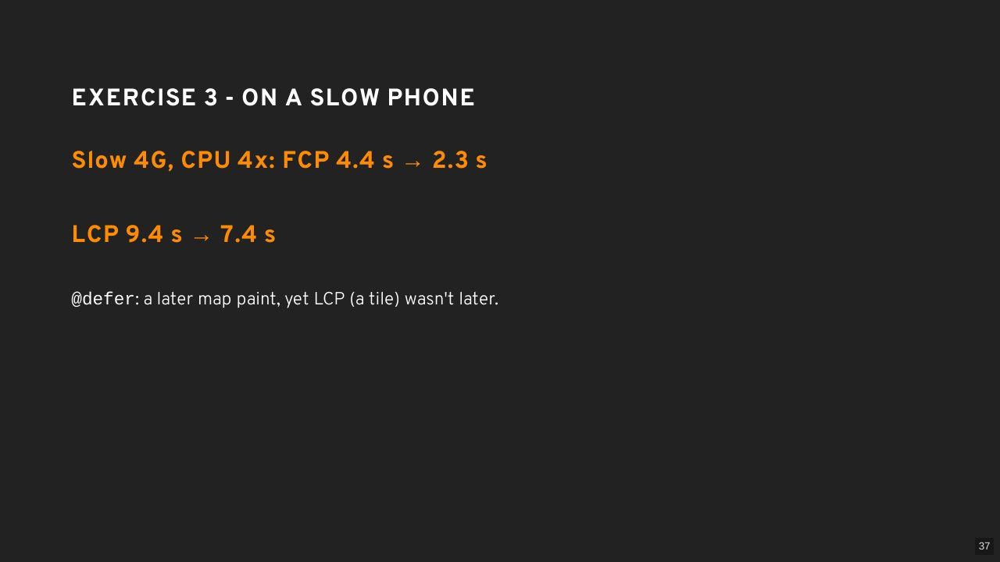

Speaker notes

> Production builds, step-3 vs step-4, npx serve with gzip, fresh context, cache off, CPU 4x, DevTools Slow 4G preset. Medians of 3: FCP 4.4 s -> 2.3 s, LCP 9.4 s -> 7.4 s. JS transferred 477 kB -> 160 kB.
> LCP element is always a map tile. Step-4 with vs without the map @defer: LCP 80 ms earlier with it (Slow 4G), 84 ms (Fast 4G).
>
> What does that mean for a user? We served both builds for real and loaded them with Chrome's Slow 4G preset and the CPU slowed down four times.
> Click. First contentful paint, when something shows: 4.4 seconds before, 2.3 after.
> Click. Largest contentful paint: 9.4 down to 7.4 seconds. It's that late because the backend takes three seconds on purpose, and the largest element is a map tile.
> Click. And the worry from the map slide: deferring the map trades a smaller first download for a map that paints later. So we measured that too: with the map deferred, LCP was not later, it was 80 milliseconds earlier, because the list and the rest of the page compete less for the network. Measure it in your app, it can go either way.

## 38. Exercise 3 - In your app

`exercise-3-in-your-app.html` · type `exercise-step`

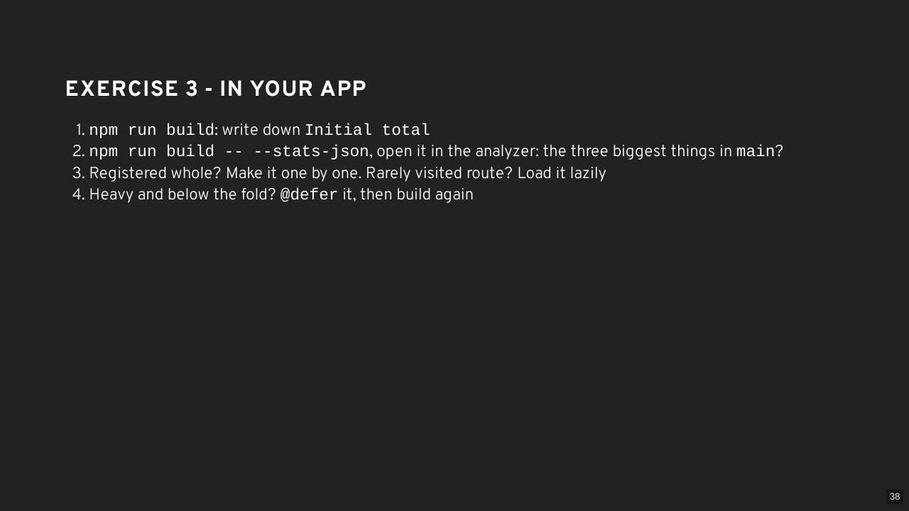

Speaker notes

> Monday homework for lab 3: Initial total, analyzer, biggest three, then the cheapest change first.
>
> Exercise 3 in your own app. Build it and write down Initial total. Then the stats flag and the analyzer, and name the three biggest things in main.
> Then work down the list: something registered whole, like icons or locales, becomes one-by-one. Routes almost nobody visits get loadComponent. Heavy components below the fold or behind a click get @defer. Build after each change.
> Ask the room: who will open the analyzer on their own app this week?

## 39. Leaks in Angular apps

`leaks-in-angular-apps.html` · type `claim-image`

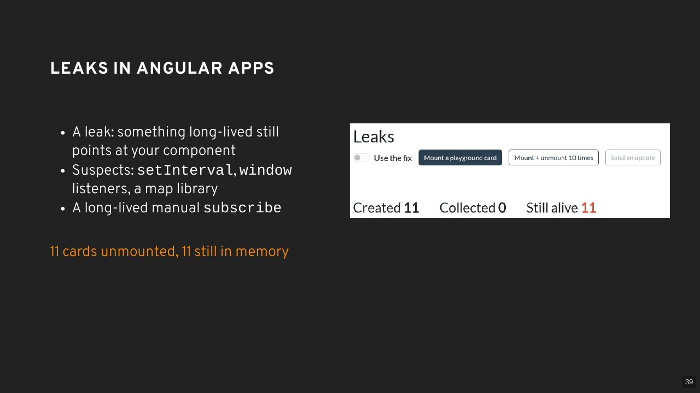

Speaker notes

> Demo: /performance/leaks. Mount a playground card, Unmount, Mount + unmount 10 times: Created 11, Still alive 11; Memory -> Collect garbage: still 11. Reload, tick Use the fix, Mount + unmount 10 times, collect garbage: Created 10, Collected 10, Still alive 0.
> Click: eleven cards nobody can see.
>
> Garbage collection frees what nothing points to. A leak is when something that lives longer than your component still points at it. In a single page app the page lives for hours, so every navigation can add one more.
> The usual suspects. setInterval: the browser holds your callback, and the callback holds the component. Listeners you put on window or document yourself. Third-party objects like a Leaflet map, which adds its own listener on window. And a subscribe you made by hand to something that outlives the component.
> Let me show you. /performance/leaks. Mount a card, unmount it, then Mount + unmount 10 times. Created 11, Still alive 11. Open the Memory tab and click Collect garbage: still 11. Nothing lets go of them.
> Reload, tick Use the fix, same clicks, collect garbage: Created 10, Collected 10, Still alive 0.
> Click. Eleven cards unmounted, eleven still in memory.
> Two of these suspects are in our app on purpose. That's exercise 4.

## 40. Exercise 4 - Find the leaks

`exercise-4-find-the-leaks.html` · type `exercise-step`

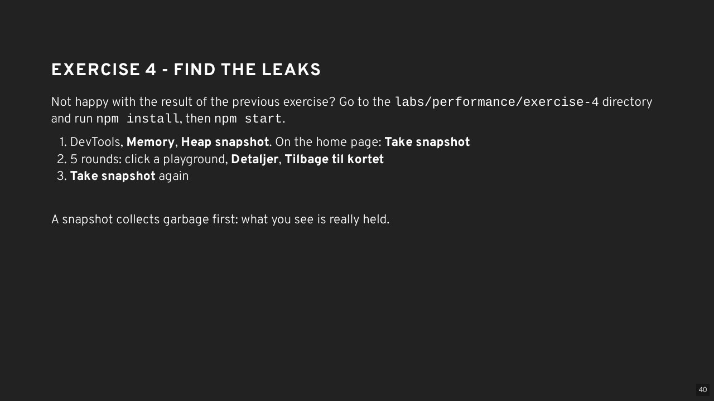

Speaker notes

> labs/performance/exercise-4. Memory, Heap snapshot, snapshot 1 on home; 5 rounds (select, Detaljer, Tilbage til kortet); snapshot 2.
> A snapshot always runs a garbage collection first. Quicker first look: the "Detached elements" profile type in the same panel lists detached DOM trees.
>
> Last exercise, and this time we don't fix anything until we've measured. If you want a clean start, labs/performance/exercise-4, npm install, npm start.
> Open DevTools, Memory, Heap snapshot. On the home page, take snapshot one. A snapshot always collects garbage before it's taken, so what's in it is really being held.
> Now five rounds. Select a playground in the list, click Detaljer in the footer, and click Tilbage til kortet on the detail page. Five times, and count them: the numbers only make sense if you know how many rounds you did. Then take snapshot two.
> If you want a quicker look in your own app later: the same panel has a profile type called Detached elements, which lists detached DOM trees straight away. Today we use the snapshot, because it also shows us the components.

## 41. Exercise 4 - Read the snapshot

`exercise-4-read-the-snapshot.html` · type `exercise-step`

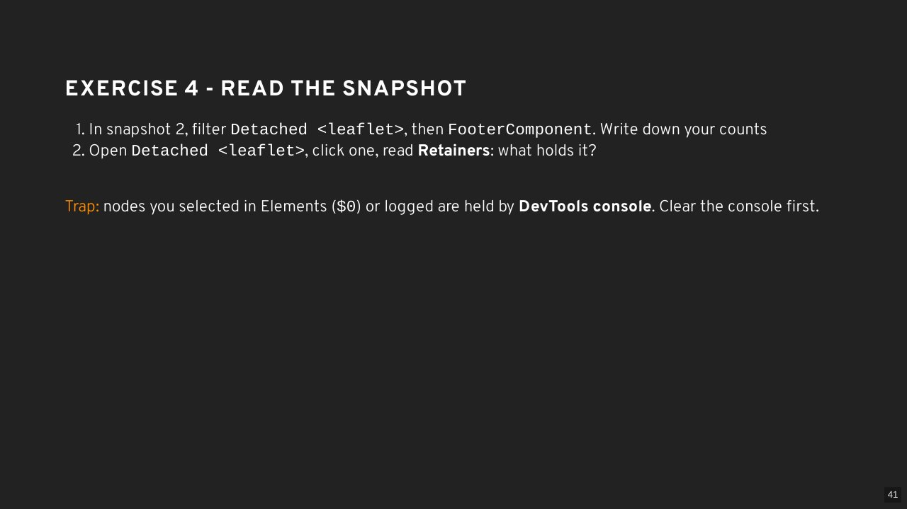

Speaker notes

> Class filter: Detached <leaflet>, then FooterComponent. Count, write down. Then Retainers on one detached leaflet. Answers on the next slide.
> There's no single "Detached" total in DevTools: one row per tag. Read the leaflet row.
>
> In snapshot two, type Detached in the class filter, and you'll see one row per tag: Detached div, Detached button, and so on. DevTools has no total for all of them, so read one row that means something: Detached <leaflet>. Write the count down. Then type FooterComponent and write that count down too.
> Then open the Detached <leaflet> row, click one of them and look at the Retainers pane underneath: the chain of references that keeps it alive. Follow it until you hit something you wrote, or a library you called. Ask the room to guess before they look.
> The trap: if you click around in the Elements panel or log a node to the console, DevTools itself holds on to it, and it shows up with DevTools console as its retainer. That's not your app. Clear the console and take the snapshot from a fresh tab.

## 42. Exercise 4 - What we found

`exercise-4-what-we-found.html` · type `exercise-result`

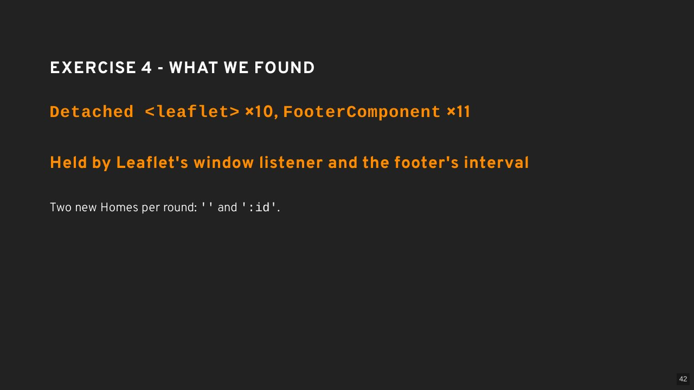

Speaker notes

> After 5 rounds (3 of 3 runs): Detached <leaflet> 10, FooterComponent 11 (1 live + 10), Detached <loop-sidebar-list-item> 1,330 (10 x 133). HomeComponent 1, LeafletComponent 1.
> Retainers: Window -> _leaflet_events -> resize handler -> L.Map (_container) -> div.leaflet-container. Next slide shows it.
>
> Click. Ten detached leaflet elements, eleven footers: one on screen, ten that should be gone. If you want a bigger number, Detached <loop-sidebar-list-item> says 1,330: ten old lists of 133 rows.
> Click. Two culprits. Leaflet's map listens for resize on window, and only map.remove() takes that listener off. And the footer's setInterval callback runs every second and holds the footer.
> Click. Why ten? Look at app.routes.ts: the empty path and ':id' are two route entries with the same HomeComponent. Selecting a playground goes from one to the other, and the router builds a new Home. Tilbage til kortet goes back to the empty path: another new Home. Two per round, five rounds, ten.

## 43. Exercise 4 - What holds the old DOM

`what-holds-the-old-dom.html` · type `claim-image`

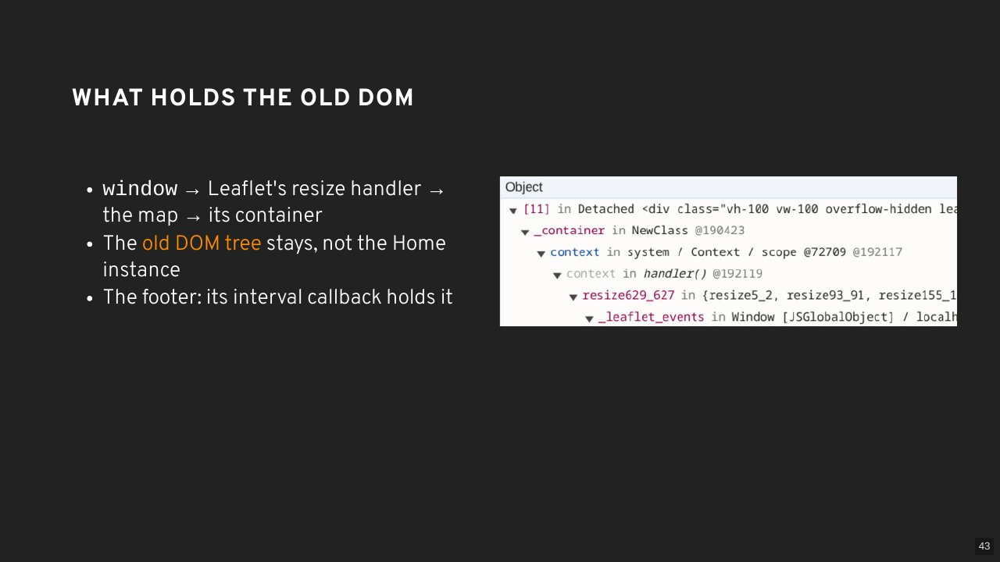

Speaker notes

> Retainers pane on a Detached <leaflet>, step-4 after 5 rounds (real DevTools). Read bottom-up: Window._leaflet_events -> resize handler -> its closure -> the map (NewClass, _container) -> div.leaflet-container -> the detached tree.
> HomeComponent count stays 1: Angular keeps a numeric LView id on DOM nodes, not a pointer to the component, so the old DOM stays alive, not the old Home instance.
>
> Here's what the Retainers pane shows. Read it from the bottom: Window has a _leaflet_events object, Leaflet's own bookkeeping. In it a resize handler. The handler's closure has the map, the map has its container div, and a detached node keeps its whole tree, up through the leaflet element to the old page.
> Be precise about what leaks. It's the old DOM tree, all 133 rows of the old list included. The old HomeComponent object is gone: the snapshot has exactly one. Angular stores a number on DOM nodes to find its view, not the component itself, so the DOM doesn't drag the component along.
> The footer is different: its setInterval callback is an arrow function that uses this, so the browser's timer list holds the footer component itself. That's the eleven.
> Ask the room: who put a listener on window? We didn't. Leaflet did, and it only takes it off in map.remove().

## 44. Exercise 4 - Cleaning up with DestroyRef

`cleaning-up-with-destroyref.html` · type `claim-code`

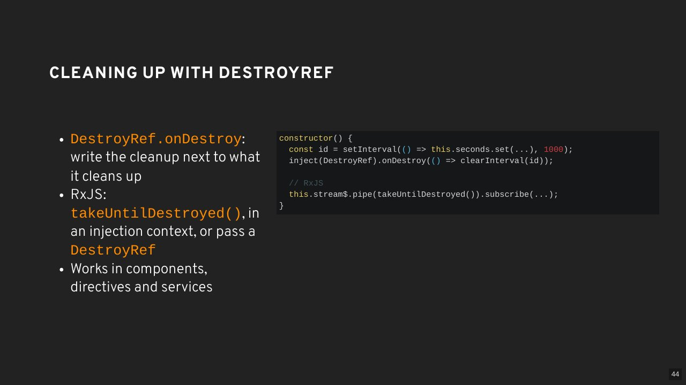

Speaker notes

> DestroyRef.onDestroy: runs when the owner (component, directive, service) is destroyed. Register synchronously, in the constructor or right after creating the thing: after an await, registering on a destroyed owner throws NG0911.
> takeUntilDestroyed() with no argument only in an injection context; pass a DestroyRef elsewhere.
>
> DestroyRef is the one tool for cleanup. Inject it, and onDestroy takes a function that runs when the component, directive or service that owns it is destroyed. Both exist since Angular 16.
> The big advantage over ngOnDestroy: you write the cleanup right next to the thing it cleans up, and you don't store the id in a field just to reach it later.
> One rule: register synchronously, when you create the thing. If you register after an await and the component was destroyed in the meantime, Angular throws NG0911.
> For RxJS there's takeUntilDestroyed. In a constructor or field initializer you call it with no argument; anywhere else, ngAfterViewInit for example, pass in the DestroyRef, or it throws because there's no injection context.
> In the exercise you do the first half for the footer and the same for the Leaflet map: after you create it, register a callback that calls remove on the map.

## 45. Exercise 4 - Fix the leaks

`exercise-4-fix-the-leaks.html` · type `exercise-step-code`

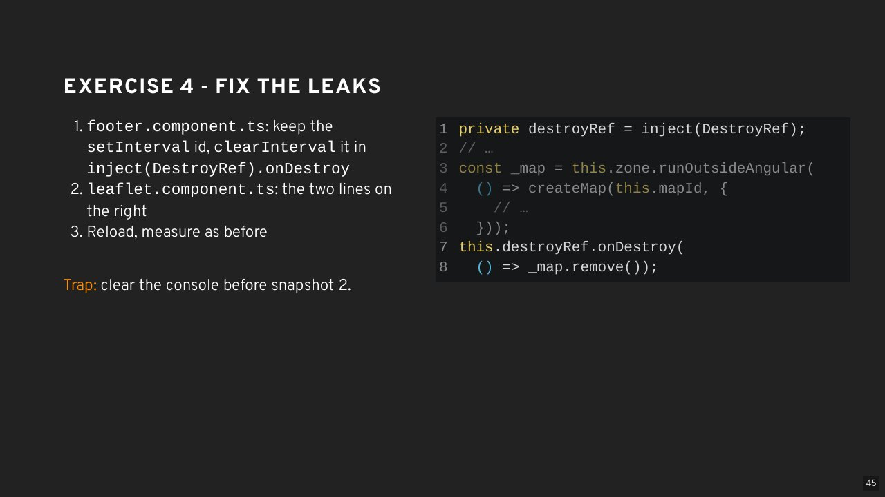

Speaker notes

> Footer: const id = setInterval(...); inject(DestroyRef).onDestroy(() => clearInterval(id)). Leaflet: field destroyRef, onDestroy(() => _map.remove()) right after the map is created. Then reload, snapshot, 5 rounds, snapshot.
>
> Two leaks, two fixes, both with DestroyRef, like on the slide a moment ago.
> In footer.component.ts: keep the id that setInterval returns, and register inject(DestroyRef).onDestroy with a clearInterval of that id, right there in the constructor.
> In leaflet.component.ts: inject DestroyRef into a field, and right after the map is created, register a callback that calls remove on the map. Import DestroyRef from @angular/core in both files.
> Then reload and measure exactly the same way: snapshot one, five rounds, snapshot two. Clear the console first, or DevTools console keeps old nodes alive and your after number lies.

## 46. Exercise 4 - Measure after

`exercise-4-measure-after.html` · type `exercise-result`

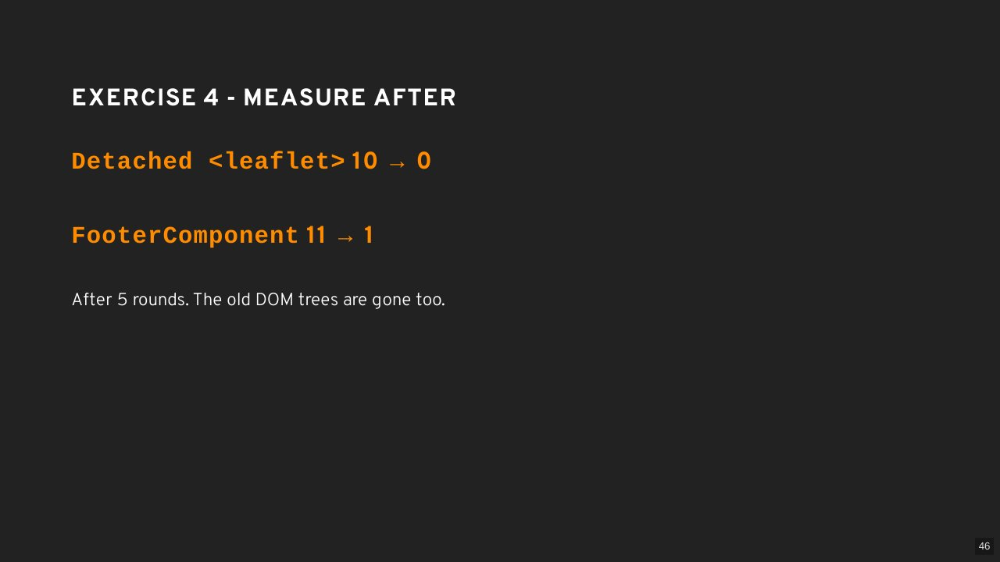

Speaker notes

> Click: Detached <leaflet> 10 -> 0 (the row is gone). FooterComponent 11 -> 1. No Detached <loop-sidebar-list-item>, <loop-home>, <loop-footer> or <footer> rows either (3 of 3 runs, step-5).
>
> Click. Detached <leaflet> goes from 10 to nothing, the row is gone. And one FooterComponent, the one on screen. The detached lists are gone too: no more 1,330 old rows.
> Ask the room: if you still saw FooterComponents growing, what would you read next? The Retainers pane, again.

## 47. Exercise 4 - Bonus: takeUntilDestroyed

`exercise-4-bonus-take-until-destroyed.html` · type `exercise-step-code`

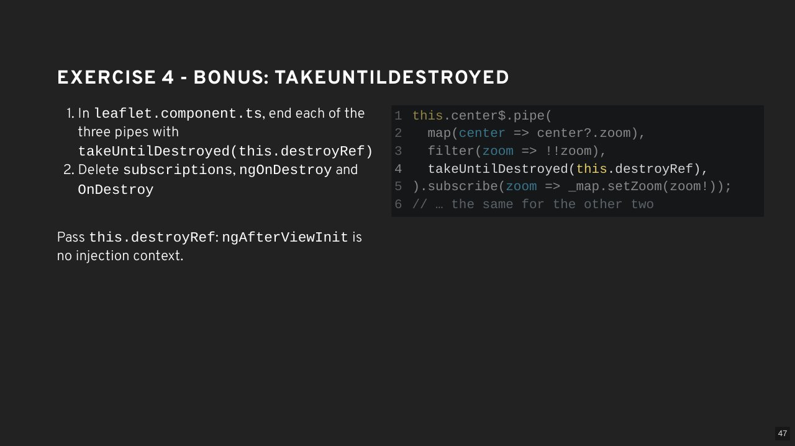

Speaker notes

> Bonus, in the solution (step-5). takeUntilDestroyed from @angular/core/rxjs-interop, this.destroyRef in all three pipes. The subscriptions array, ngOnDestroy, OnDestroy and the Subscription import go.
>
> For the fast ones. The Leaflet component still collects its three subscriptions in an array and unsubscribes in ngOnDestroy. That works, but it's the old pattern. Give each of the three pipes takeUntilDestroyed as its last operator, imported from @angular/core/rxjs-interop, and delete the array, ngOnDestroy, OnDestroy from implements and the Subscription import.
> Pass this.destroyRef. We're in ngAfterViewInit, which is not an injection context, so takeUntilDestroyed without an argument throws.
> It's in the solution, so compare with that afterwards.

## 48. Exercise 4 - In your app

`exercise-4-in-your-app.html` · type `exercise-step`

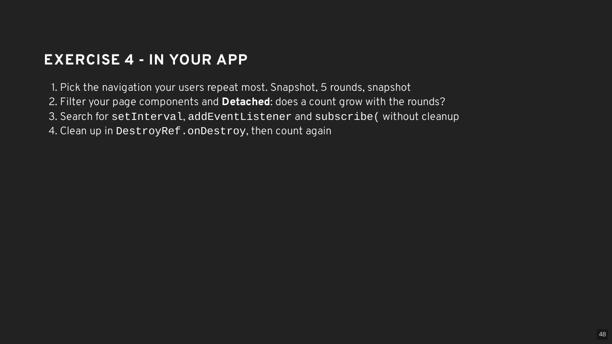

Speaker notes

> Monday homework for lab 4: two snapshots around the leakiest navigation, then grep.
>
> Exercise 4 in your own app. Pick the navigation your users do over and over: open a record, back to the list. Snapshot, five rounds, snapshot. Filter on your page components and on Detached: if a count grows with the number of rounds, you've got a leak, and the Retainers pane tells you who holds it.
> Then search for the usual suspects: setInterval, addEventListener and subscribe calls without a takeUntilDestroyed or other cleanup. Fix with DestroyRef, and count again.

## 49. The fixes of the day

`wrap-the-fixes-of-the-day.html` · type `wrap`

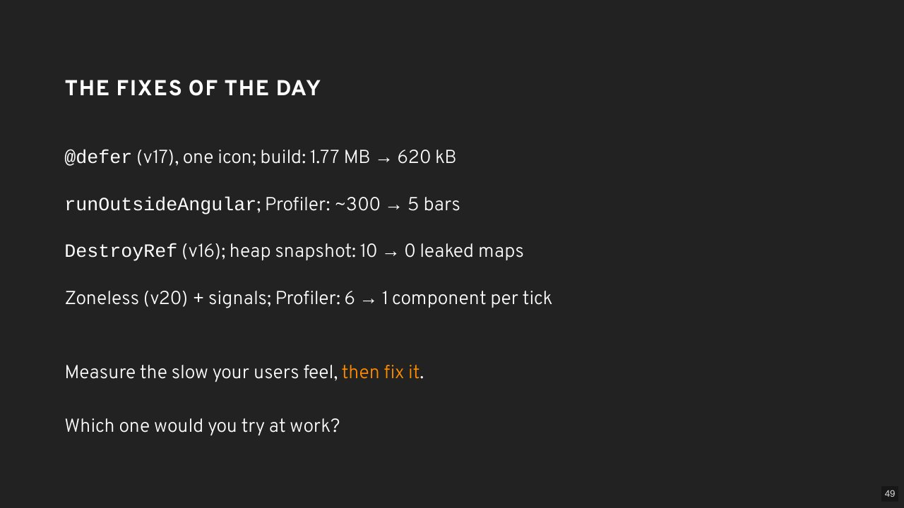

Speaker notes

> Four fixes, in the order they paid off in THIS app. Yours will differ: measure. Read the Monday line out. Click: the question.
>
> Here's the day on one slide, in the order they paid off in our app.
> One: load less. Our first download was 1.77 megabytes, and the biggest part wasn't the map, it was an icon library we registered in full. The analyzer showed it. Only the icon we use, a lazy route and a deferred map, and Initial total was 620 kilobytes. On a slow phone, first paint went from 4.4 to 2.3 seconds. @defer needs Angular 17.
> Two: the map's mouse events ran change detection for the whole app. Five seconds of mouse moves, about 300 Profiler bars, 229 milliseconds of change detection on a slow CPU. One runOutsideAngular, and it was 5 bars and 6 milliseconds. Works in every version that has zone.js.
> Three: every visit left the old page's DOM and a footer behind. After five rounds, ten detached maps in the heap snapshot. Two onDestroy callbacks, and it was 0. DestroyRef needs Angular 16.
> Four: zoneless and signals. When the footer ticks, the Profiler shows Angular checking the footer instead of all six components, and the list click went from 46 bars to 2. Stable from Angular 20. It pays more the bigger your component tree is.
> So on Monday: in your own app, start with the kind of slow your users complain about, not the fix you liked best today. Measure that first: Initial total from the build, bars in the Profiler, or counts across two heap snapshots. Write the number down, change one thing, measure again.
> Click. Ask the room: which one would you try at work, and what would you measure first? Let two or three people answer.

## 50. Time for questions 🤓

`time-for-questions.html` · type `statement`

Speaker notes

> Questions. If it's quiet, ask the Monday question.
>
> Any questions about today, or about your own app? If it's quiet, ask the room: what will you measure first in your own app on Monday? Build size, Profiler bars or a heap snapshot? Let one or two people say why.

