# Performance & Change Detection: slide preview

Rendered from the uncommitted lift on the `performance` worktree. 36 visible slides; hidden slides are not shown. Fragments show their final state.

## 1. Performance & Change Detection

`performance.html`

Speaker notes

> Performance & Change Detection: one day, four labs on the playground app.
> Ex 1 leave the zone, ex 2 zoneless and signals, ex 3 load less, ex 4 memory.
> Rule of the day: measure, change, measure again.
>
> Welcome. Today we make the playground app faster, and we only believe numbers.
> The app is slow in ways you can see in a profiler. In every lab you measure first, change one thing, and measure again to see the number move.
> Four labs: take the map out of the zone, go zoneless with signals, load less up front, and clean up what leaks.
> Ask the room who has opened a profiler on their own app. That tells you how long to stay on the tools slides.

## 2. What does "slow" mean?

`what-slow-means.html`

Speaker notes

> Three kinds of slow, each with its own tool and its own number.
> Click: the rule of the day. Every exercise has a measure before and a measure after.
>
> When a user says the app is slow, ask which slow. Interaction is lag: you move the mouse or click and the screen answers late, usually because Angular does too much work per event. Startup is the wait before you can use it: JavaScript to download, parse and run. Memory is slow over time: fine when you opened it, heavy an hour later because things were never cleaned up.
> Each kind has its own tool, and a fix for one does nothing for the others. The last column is what you write down before you touch any code.
> Click. That's the only rule today. Measure, change exactly one thing, measure again in exactly the same way. Developers are bad at guessing where time goes, and a fix that does nothing still feels like progress.
> Ask the room: which of the three did your last "the app is slow" ticket mean?

## 3. Change detection in one minute

`change-detection-in-one-minute.html`

Speaker notes

> Demo: /performance/change-detection. All Eager, click "click" on E: all seven nodes flash, checks 1 each. All OnPush, Reset, same click: only E, B, A flash.
> Cost = components checked x bindings, per cycle. When: zone.js. Which: Eager vs OnPush.
>
> Change detection keeps the screen in sync with your data. After something happens, Angular walks the tree from the root and compares every binding with its old value.
> So the cost is easy to state: how many components are checked, times how many bindings they have, once per cycle. Two levers: how often does a cycle run, and how many components does each one check?
> Switch to the demo. All Eager, Reset counters, click "click" on E. Every node flashes yellow, seven checks for one click on a leaf. Now All OnPush, Reset, the same click: only E, B and A. Ask the room: why A and B, when nobody clicked them? They're on the path from E to the root.
> Click for the last line. Zone.js decides when cycles run in today's app. It patches events, timers and promises, and runs a cycle after every one. It knows a task finished, not that anything changed. Remember that for the map in exercise 1.

## 4. Angular DevTools: the Profiler

`angular-devtools-profiler.html`

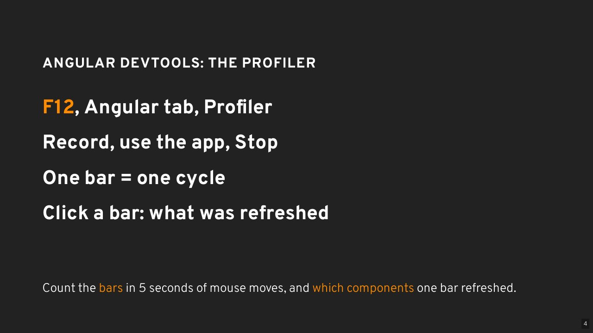

Speaker notes

> F12, Angular tab, Profiler, Record, use the app, Stop.
> One bar = one cycle. Click a bar: components refreshed + time.
>
> Our first tool. Angular DevTools is a Chrome extension. Check that everyone has it now, it's a one-minute install and you can't do the first two labs without it.
> Open DevTools, there's an Angular tab, and inside it a Profiler. Press Record, do something in the app, press Stop. Every bar is one change detection cycle. Click a bar and you see which components were refreshed and how long each took.
> Click for the punchline. The easiest number to compare is how many bars you get for the same thing done twice, and what one bar refreshed. That's the before and after for the next two exercises.
> It only works on a development build, which is what npm start gives you. Ask the room: has anyone recorded their own app with this? What did one click cost?

## 5. Exercise 1 - Getting started

`exercise-1-getting-started.html`

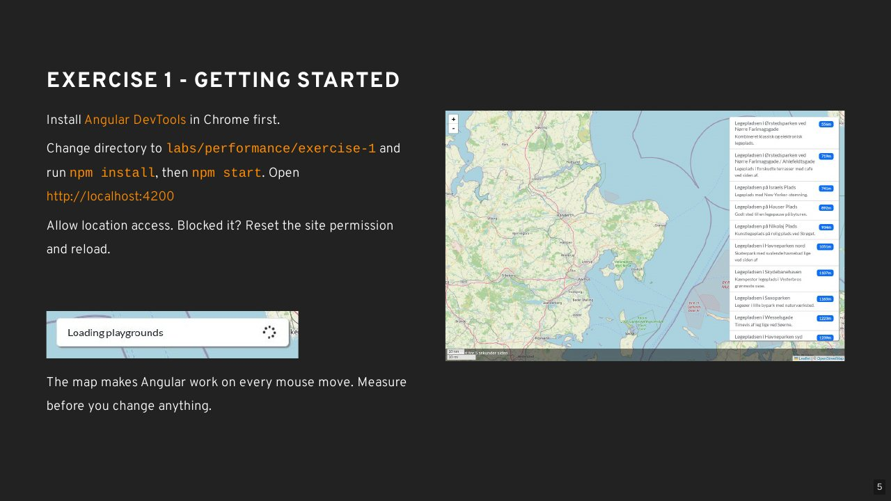

Speaker notes

> Angular DevTools installed? labs/performance/exercise-1, npm install, npm start, http://localhost:4200.
> Location: allow it, the list waits. Blocked it? "Loading playgrounds" forever: reset the site permission and reload.
> The backend is slow on purpose: about 3 seconds of spinner.
>
> Time for exercise 1. First check that everyone has Angular DevTools in Chrome.
> Go to labs/performance/exercise-1, npm install, npm start, open localhost:4200. The browser asks for your location: allow it, the playground list waits for it. If you blocked it by accident, the card says Loading playgrounds forever, like the small picture. Click the icon left of the address, reset the location permission and reload.
> The backend is slow on purpose, so you see a spinner for about three seconds. Then you get the map, the list and the footer counting seconds, like the screenshot.
> This is the playground app from the signals course with problems planted in it. Ask the room: move the mouse over the map. Does it feel slow? It doesn't, on your laptop. That's why we measure. Next slide.

## 6. Exercise 1 - Measure before

`exercise-1-measure-before.html`

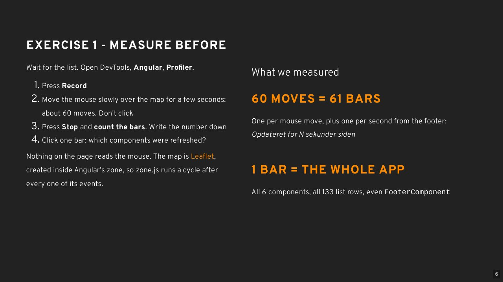

Speaker notes

> Record, ~60 mouse moves over the map, no clicks, Stop. Count the bars.
> Click: 61 bars for 60 moves. Click: one bar refreshed all 6 components and all 133 rows.
> Why: Leaflet registers its listeners when the map is created, inside the zone.
>
> Measure before. Wait until the list is there, open the Angular tab, Profiler, press Record. Move the mouse slowly over the map for a few seconds, no clicks, no zoom. Stop.
> Click. In our run, 60 mouse moves gave 61 bars: one per move, plus one from the footer's one-second timer. Your number will differ a bit, write yours down.
> Click. Now click one of the bars. It refreshed all six components on the page and all 133 rows in the sidebar, because a mouse moved over a map.
> Ask the room: what on this page needs to know where the mouse is? Nothing. Leaflet adds its mousemove, drag and zoom listeners when it creates the map, and we create it inside Angular's zone, so zone.js patches them and runs change detection after each one. Next slide: how to step outside the zone.

## 7. Running outside Zone.js

`running-outside-zone-js.html`

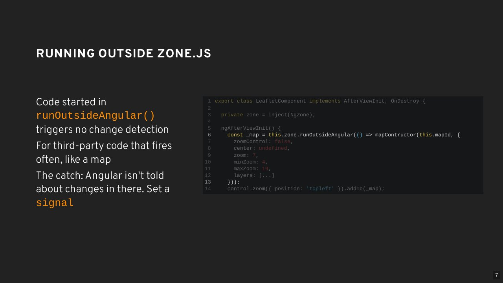

Speaker notes

> Demo: /performance/change-detection. All Eager, click setTimeout on B: every node flashes, checks 2 each (zone entry + timer). Reset, click "outside zone" on B: nothing flashes, B's field stays stale.
> The function returns the map, so const _map stays.
>
> Here's the tool. NgZone.runOutsideAngular takes a function and runs it outside the zone. Anything it starts, event listeners and timers, isn't patched, so Angular doesn't run change detection after them.
> Switch to the demo. All Eager, Reset counters, click setTimeout on B. Every node flashes, and the counters say two checks each: one for the click, one for the timer. Reset, click outside zone on B. Nothing flashes. B's field did change, but the screen still shows the old value. Ask the room: when will B show the new number? At the next cycle, whatever starts it.
> That's the catch. You're cutting the wire between this code and Angular. Fine for a map that draws its own DOM. If a template depends on it, set a signal.
> The code is exercise 1. Click: the map is created inside runOutsideAngular, and the arrow function returns it, so const _map still works. Leaflet adds its listeners when the map is created, so wrapping creation is enough.

## 8. Exercise 1 - Leave the zone

`exercise-1-leave-the-zone.html`

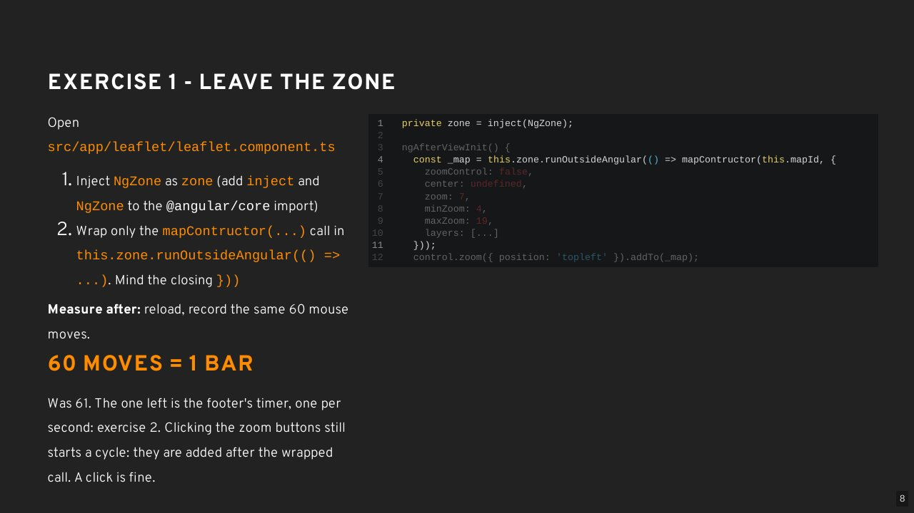

Speaker notes

> Inject NgZone, wrap mapContructor(...) only. Reload.
> Click: 60 moves = 1 bar, was 61. The one left is the footer timer.
> Zoom buttons and marker hovers are added after creation, so they still run in the zone.
>
> Now the fix. Open leaflet.component.ts. Inject NgZone, and in ngAfterViewInit wrap just the call that creates the map. It's one expression, so it becomes an arrow function that returns the map. Watch the closing: two parentheses after the options object. Add inject and NgZone to the import from @angular/core.
> Measure after. Reload, record the same 60 mouse moves. Click. One bar, where you had 61. The one left is the footer's one-second timer, and that's exercise 2.
> Ask the room: why is wrapping creation enough, when the mouse moves long after? Because Leaflet registers its listeners at creation. Created outside the zone, never patched.
> Small caveat: the zoom buttons are added after the wrapped call, so clicking them still runs a cycle. That's fine, it's a click, not a stream.

## 9. Exercise 1 - Bonus: try it, then revert

`exercise-1-bonus.html`

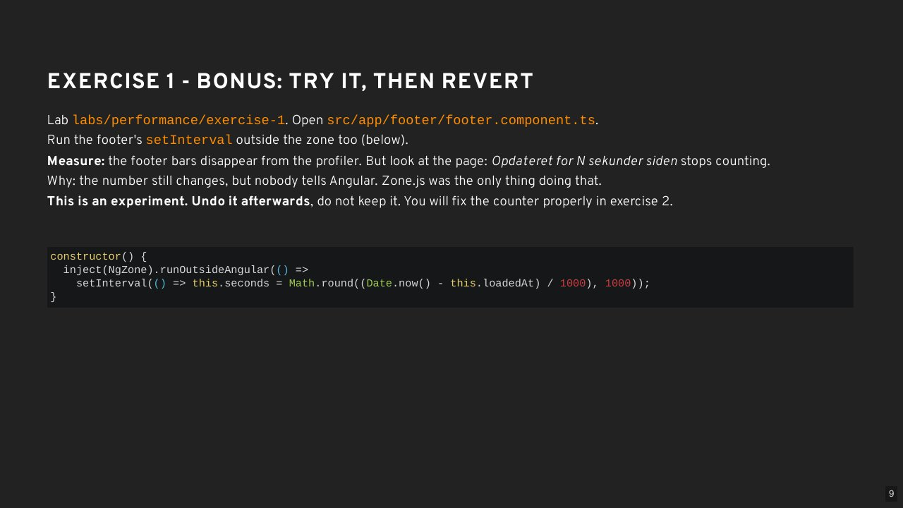

Speaker notes

> TRY AND REVERT. Not part of the solution.
> Footer interval outside the zone: bars gone, counter frozen (updates only when something else runs CD, like a click on a playground).
> Point: zone.js was the trigger. Plain field + no zone = no update. Lead-in to exercise 2.
> Revert before the break.
>
> A bonus for the fast ones, and it is a try and revert experiment. Do not keep this change.
> The footer counts seconds with a setInterval that writes a plain field. Wrap that interval in runOutsideAngular, the same trick as for the map. Look at the profiler: the footer's bars are gone. Great? Look at the page. The counter has stopped. The field is still updating, but the screen is not, because nothing tells Angular to check the footer. It only moves if something else triggers a cycle, for example if you click a playground.
> That is the whole lesson: the only reason the counter ever updated was zone.js, running a cycle after each timer tick. Runs outside the zone, no cycle, no update.
> Now undo it, so you start the break with the working footer. After the break we remove zone.js completely and the same thing will happen to the whole app, and then we fix it the right way.

## 10. From Zone.js to zoneless

`from-zone-js-to-zoneless.html`

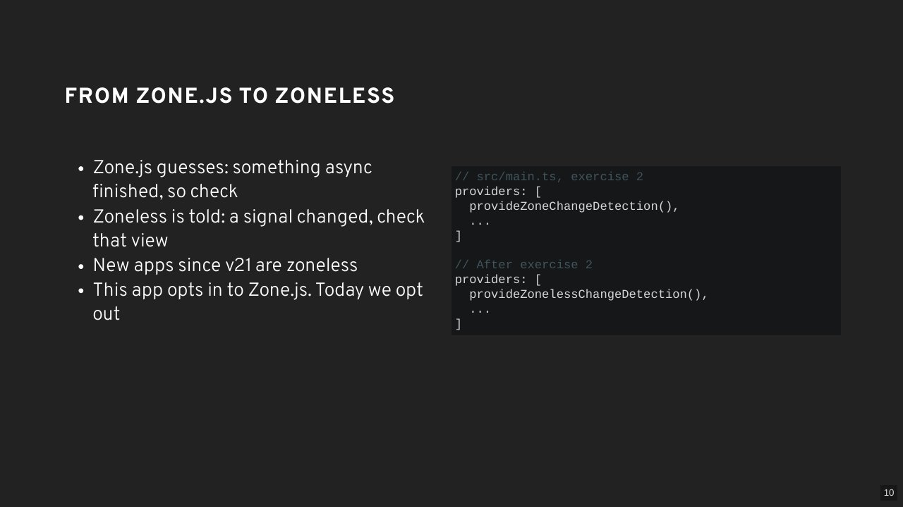

Speaker notes

> Recap from signals. Guesses vs is told.
> runOutsideAngular from exercise 1 can stay: it still compiles and does nothing harmful zoneless.
>
> You saw this slide in the signals course, so one minute. Zone.js guesses: an event or a timer finished, so maybe something changed, check. Zoneless is told: a signal a template reads changed, so refresh that view.
> New apps since v21 are zoneless and write nothing in main.ts. Our app still says provideZoneChangeDetection. In exercise 2 you swap it for provideZonelessChangeDetection and take zone.js out of the build.
> Your runOutsideAngular from exercise 1 can stay. Ask the room: what will happen to the footer counter when the zone is gone? Hold that thought, next slide.

## 11. Zoneless: what schedules change detection?

`what-schedules-change-detection.html`

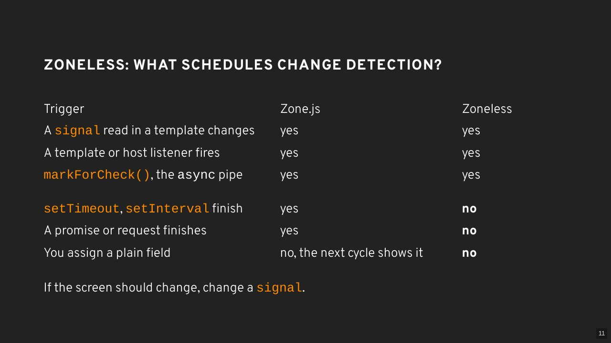

Speaker notes

> Demo: /performance/change-detection. All OnPush, signal on B: only B flashes. setTimeout on B: nothing flashes, B keeps field 0; click "click" on B: A and B flash, field jumps to 1.
> Click: the rows zoneless does NOT schedule. Click: the rule.
>
> Here's the list to keep in your head. Top three: a signal read in a template, a listener in a template, markForCheck, which the async pipe calls for you. Those schedule a cycle with or without Zone.js.
> Click. The bottom three used to work only because the zone ran a cycle after every timer and every finished request. Zoneless, they schedule nothing. The footer's setInterval writes a plain field, so ask the room: what happens to the footer counter in exercise 2? It freezes.
> Switch to the demo. All OnPush, Reset. Click signal on B: only B flashes. Click setTimeout on B: nothing flashes, B still shows field 0. Click "click" on B: A and B flash, and now the field jumps to 1. The value was there all along, nobody asked Angular to look.
> Click. The rule of thumb: if the screen should change, change a signal.

## 12. OnPush is the default (v22)

`onpush-is-the-default.html`

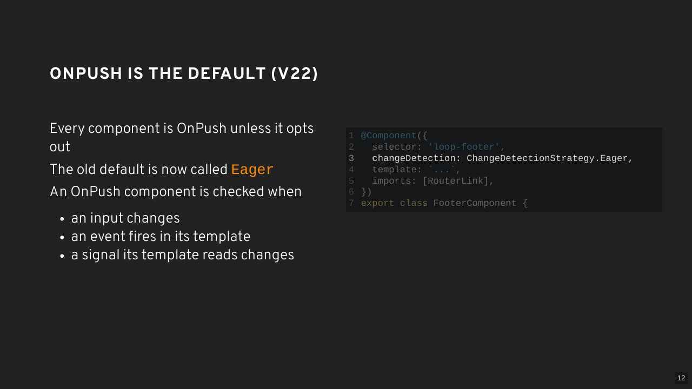

Speaker notes

> Recap from signals. Eager = the old Default: checked whenever the traversal reaches it.
> Exercise 2: footer counter becomes a signal, then the Eager line goes, in all seven components.
>
> Since Angular 22 every component is OnPush unless it says otherwise. The old default is now called Eager, and Default is a deprecated alias for it.
> Eager means: check me every time change detection walks past. That's how the footer's plain field works under Zone.js: the zone runs a cycle every second, the footer is checked, the new number shows. ng update adds Eager to every component so nothing changes behaviour, and our app looks exactly like that.
> An OnPush component is checked when an input changes, an event fires in its template, or a signal its template reads changes. The third one is exercise 2: make the counter a signal, then the Eager lines can go.
> Ask the room: in your own app after ng update to 22, how many Eager lines are there? That's your to-do list.

## 13. Exercise 2 - Measure, then go zoneless

`exercise-2-go-zoneless.html`

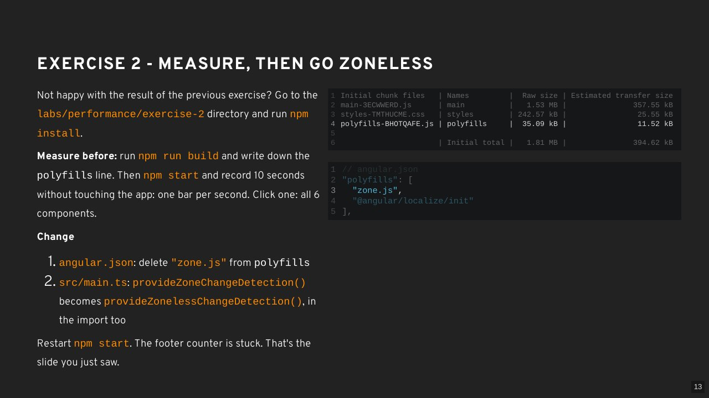

Speaker notes

> labs/performance/exercise-2. Before: polyfills 35.09 kB, one footer bar per second, each refreshes all 6 components.
> Change: zone.js out of polyfills, provideZonelessChangeDetection in main.ts.
> Expect: the counter freezes. Next slide fixes it.
>
> Exercise 2 starts with a measurement, as always. If your exercise 1 isn't working, go to labs/performance/exercise-2 and run npm install.
> Run npm run build and look at the polyfills line: 35 kilobytes, 11.5 over the wire. That's zone.js. Then npm start and record ten quiet seconds in the profiler: one bar per second, the footer's timer, and clicking a bar shows it refreshed all six components.
> Now the change. In angular.json delete the zone.js line from polyfills. In main.ts swap provideZoneChangeDetection for provideZonelessChangeDetection, in the import too. Leave runOutsideAngular from exercise 1 where it is.
> Restart and look at the footer. Ask the room: why did the counter stop? A timer writes a plain field, and nothing tells Angular. Next slide fixes it.

## 14. Exercise 2 - Fix the footer with a signal

`exercise-2-fix-the-footer.html`

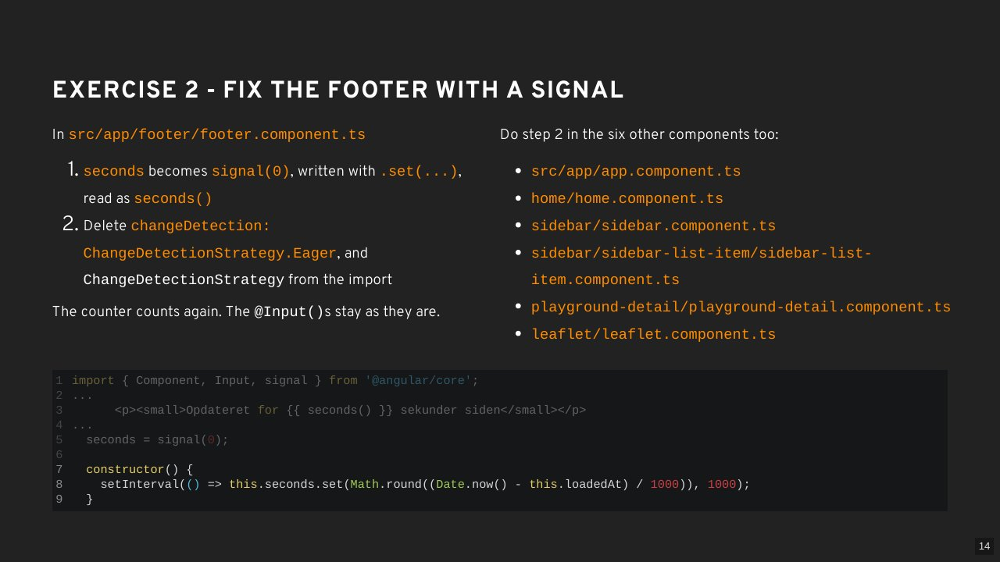

Speaker notes

> footer: signal(0), .set(), seconds() in the template. Delete changeDetection + the ChangeDetectionStrategy import, in all seven components.
> @Input()s stay: an input set by the parent marks the view.
>
> The fix is small. Make seconds a signal, set it in the interval, call it in the template. Step through the highlights: the import, the template call, the signal, the set.
> Then the Eager line goes, in the footer and in the six other components: app, home, sidebar, list item, detail page and the Leaflet wrapper. Only remove ChangeDetectionStrategy from the import, the other names on that line stay. Now nothing is checked just because change detection walks past.
> Ask the room: why does the counter work without markForCheck? The template reads the signal. When the interval sets a new value, Angular marks exactly that view and schedules a cycle.
> Next slide: measure after.

## 15. Exercise 2 - Measure after

`exercise-2-measure-after.html`

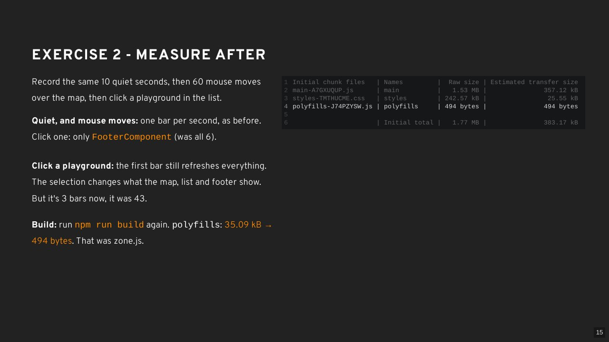

Speaker notes

> Click: idle / mouse = 1 bar per second, Footer only (was all 6).
> Click: a list click still refreshes the whole tree once. 3 bars, was 43. Don't claim "footer only" for clicks.
> Click: polyfills 35.09 kB -> 494 bytes. main is about the same: the saving is zone.js.
>
> Measure after, the same way as before. Ten quiet seconds, then the mouse over the map, then a click in the list.
> Click. Quiet: still one bar per second, because the number really does change every second. But click the bar: only FooterComponent. Before, that tick refreshed all six components and 133 rows. Mouse over the map: nothing new.
> Click. Be honest about the list click. The first bar still refreshes everything, and it should: the selection changes what the map, the list and the footer show. What changed is the tail. Under zone.js that one click gave us 43 bars, now it's 3.
> Click. Build again and compare the polyfills line: 35 kilobytes down to 494 bytes. main is practically the same size, so don't look there. The saving is zone.js itself.
> Ask the room: three states now. Step one, a bar per mouse move. Exercise 1, only the timer, but the whole app. Now, only what changed. Which one is your app at work?

## 16. Reading the build output

`reading-the-ng-build-output.html`

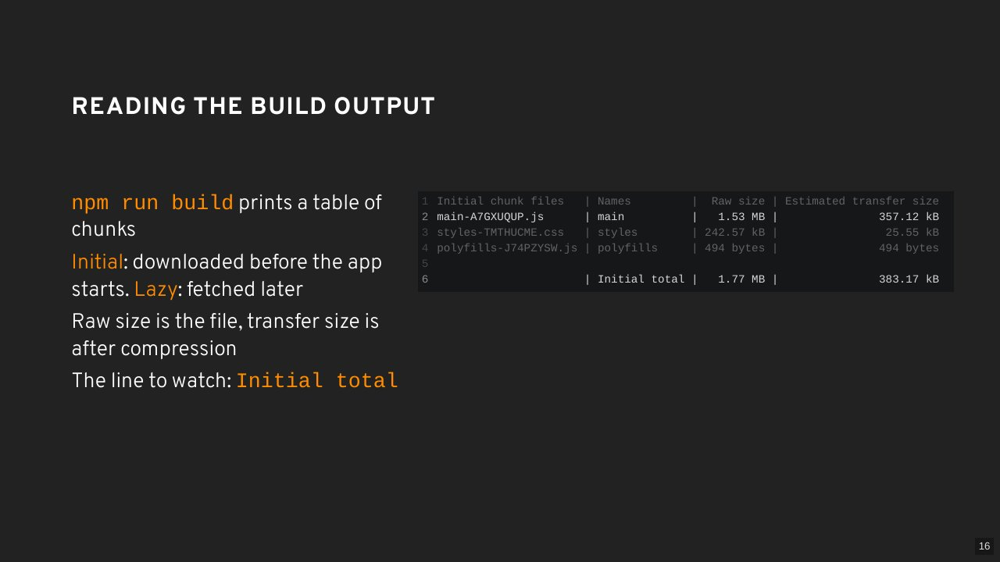

Speaker notes

> Initial = downloaded before anything shows. Lazy = fetched later (no lazy table yet).
> Raw is the file, transfer is the estimate after compression. Look at both.
> This is the exercise 3 starting point: zoneless, nothing lazy. Initial total 1.77 MB / 383.17 kB, main 1.53 MB.
> Optional: ng build --stats-json writes stats.json for a bundle analyzer.
>
> Before we change anything, we learn to read what the build tells us. npm run build, and look at this table.
> It's the initial chunk files: everything the browser has to download and run before the app starts. The Initial total line is the number we want to push down.
> Raw size is the file on disk. Estimated transfer size is what goes over the wire after compression. Users on a slow connection feel the second one; parsing and running cost the first one.
> Once something is lazy, a second table shows up: lazy chunk files. You'll see it appear in the exercise.
> Ask the room: main is 1.53 MB. What do you think is in there? Write your guess down, we'll check it after the exercise.
> The hashes in the file names change between builds. That's fine, it's how the browser cache knows a file is new.

## 17. Lazy routes

`lazy-routes.html`

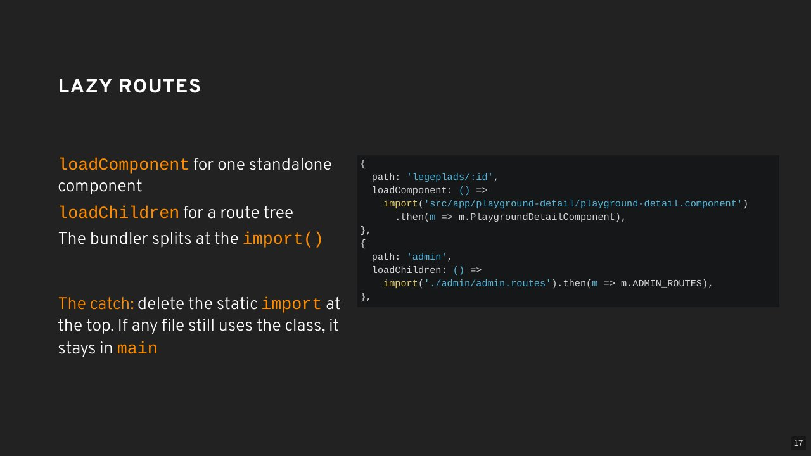

Speaker notes

> loadComponent for one component, loadChildren for a whole route tree.
> Both take a function returning import(). The bundler splits at the import.
> The detail route in the exercise gets a chunk of about 1 kB: small, but the pattern is the point.
> Trap on the slide: the static import at the top must go.
>
> A lazy route is a route whose code isn't in the first download. You give the router a function that calls import(), and the build puts that file in its own chunk.
> loadComponent is for one standalone component. That's what you do in the exercise for the detail route, legeplads/:id.
> loadChildren is for a group of routes, say everything under /admin. The imported file exports a Routes array, and if it's the default export you don't even need the then.
> The catch: it only works if nothing imports the component the normal way. Leave a real use of the class in another file and the chunk is right back in main. The build won't warn you, so you check the lazy table.
> Ask the room: which routes in your app does almost nobody visit? Those are your first loadComponent candidates.
> The functions run in an injection context, so you can call inject() inside them if you need to.

## 18. @defer and its triggers

`defer-triggers.html`

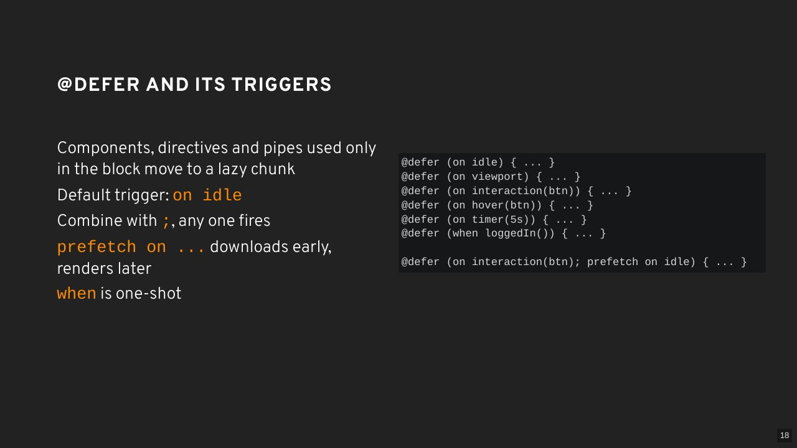

Speaker notes

> Demo: /performance/defer (in demo/: npm run start:no-hmr). Network, filter JS, reload: idle + prefetch chunks at once, timer at 3 s; hover "Hover me": hover-loaded chunk. Click "Downloaded already. Click me": renders with no new request.
> Each card names the chunk it came from.
>
> @defer is lazy loading for part of a template. Everything inside the block that's only used there, components, directives, pipes, goes into its own chunk and is fetched when the trigger fires.
> Let me show you. Network tab, filter JS, reload. The idle card and the prefetch chunk come in right away, the timer card three seconds later. Ask the room: what do you think happens when I hover "Hover me"? A new request, hover-loaded. Now the prefetch card: "Downloaded already. Click me". I click, it renders, and there's no new request. That's prefetch: download early, show later.
> Triggers: on idle waits for the browser to be idle, and it's the default. On viewport waits for the placeholder to scroll into view. On interaction and on hover react to the user. On timer waits a fixed time. When takes any condition, and it's one-shot: once true, the block stays.
> Several triggers are combined with a semicolon and any one of them fires.
> In the exercise you wrap the map in on idle and the footer in on viewport. Don't guess which change is the biggest win: measure it.

## 19. @placeholder, @loading and @error

`defer-placeholder-and-loading.html`

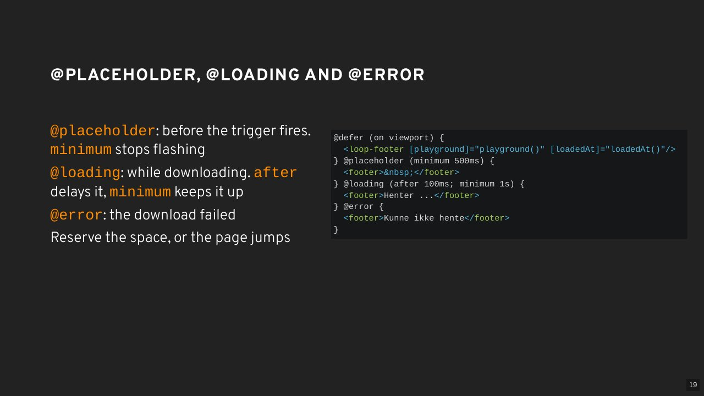

Speaker notes

> Demo: /performance/defer. Throttle Slow 4G, reload, click "Click me": "Loading ..." for about a second, then the card naming interaction-loaded.component-….js.
> @placeholder until the trigger, @loading while downloading, @error if it fails. Reserve the space.
>
> The block has up to three companions. The placeholder is what the user sees before the content is requested. The loading block shows while the chunk downloads. The error block shows if the download fails.
> Let me show you the loading block. Throttle to Slow 4G, reload, click "Click me" on the interaction card. "Loading ..." for about a second, then the real card. Ask the room: without throttling, would you have seen it at all?
> Two timers stop flicker. In placeholder, minimum is how long it stays once shown. In loading, after delays showing it, so a fast download never shows a spinner at all, and minimum keeps it up long enough to read.
> Reserve the space. If the placeholder isn't the size of the content, the page jumps when the content arrives. That's layout shift, and it counts against you. In the exercise the map placeholder is an empty full-size div and the footer placeholder is an empty footer.
> Whatever the placeholder, loading and error blocks use is loaded eagerly, so keep them cheap.

## 20. What stays eager

`defer-what-cant-be-deferred.html`

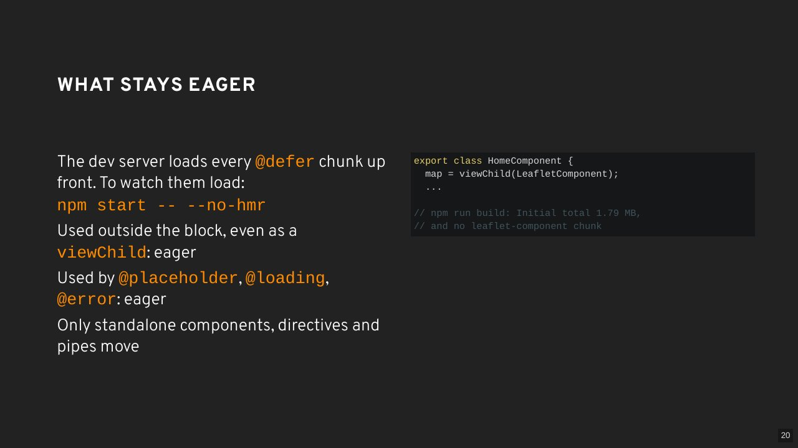

Speaker notes

> 30 seconds, a list of "don't".
> HMR loads defer chunks eagerly: npm start -- --no-hmr to see them load. Same command on the exercise slide.
> viewChild(LeafletComponent) in Home on top of @defer: no leaflet chunk, Initial total 1.79 MB (measured on a copy of the exercise 3 start).
> SSR renders the placeholder, triggers don't run on the server.
>
> @defer only moves code that nothing else needs at start, and there are a few quiet ways to lose the win.
> First one, and it bites everybody: in development, hot module replacement loads every defer chunk up front, so in the Network tab it looks like defer does nothing. Start with npm start -- --no-hmr and you see the real behaviour.
> Second: if anything outside the block uses the component, it stays eager. Here I deferred the map and added one viewChild of LeafletComponent in Home. The build has no leaflet chunk any more, and Initial total is 1.79 MB, a bit worse than doing nothing. Ask the room: how would you notice that in a code review? You wouldn't. You notice it in the lazy table of the build.
> What the placeholder, loading and error blocks use is eager too, so keep them cheap.
> And only standalone things move. In a modern app that's everything, but in an older one with NgModules, check.
> With server-side rendering the server renders the placeholder and the triggers don't run there.

## 21. Images: ngSrc

`optimized-images-ngsrc.html`

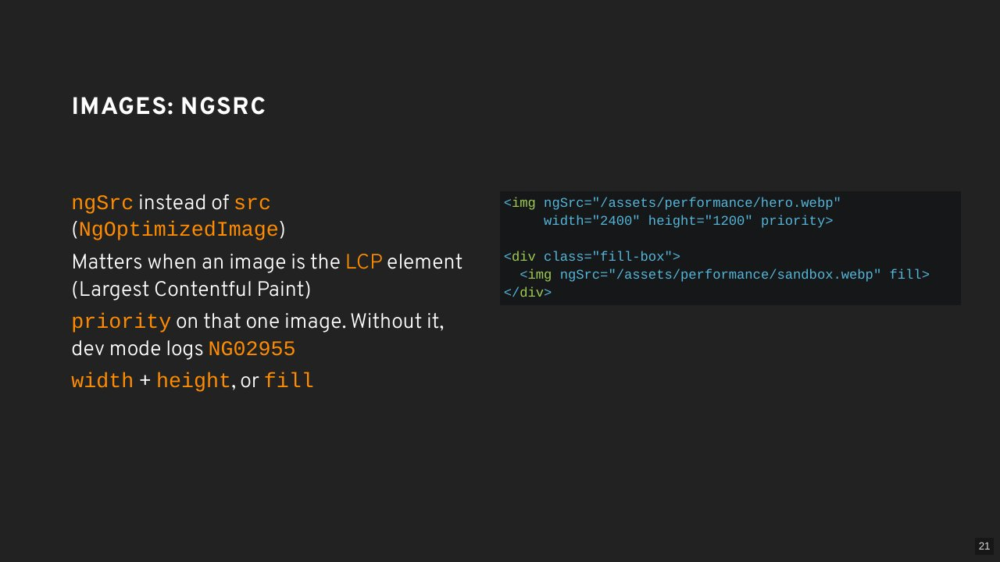

Speaker notes

> Demo: /performance/images. Console open, click Reload without priority: error NG02955 for hero.webp. Click Reload with priority: console clean.
> 30 seconds. The playground app has no big images, so there's no exercise. Know it for when you do.
>
> Replace src with ngSrc and import NgOptimizedImage. You get lazy loading by default, a srcset when you configure an image loader, and dev mode warnings for the usual mistakes.
> It matters most for LCP, Largest Contentful Paint: the time until the biggest thing above the fold has rendered. Often that's a hero image. Put priority on that one: it gets fetch priority high, isn't lazy, and with server-side rendering it's preloaded.
> Let me show you. Console open, Reload without priority: NG02955, Angular telling us the LCP image has no priority. Reload with priority: clean.
> Width and height are required, so the browser reserves the space and the page doesn't jump. If you don't know the size, use fill with a positioned parent, like the second image here.
> Ask the room: which image on your own start page is the LCP element? Don't put priority on everything, then it means nothing. One image per page, usually.

## 22. Exercise 3 - Measure the build

`exercise-3-getting-started.html`

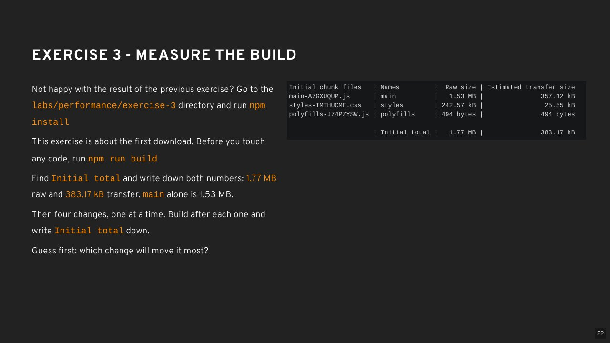

Speaker notes

> Lab exercise-3. npm run build before any change. Expect Initial total 1.77 MB / 383.17 kB, main 1.53 MB.
> Everyone writes their guess down: which of the four changes wins?
>
> New exercise, and this one is about the first download. Go to labs/performance/exercise-3, npm install, and before you touch any code, npm run build.
> Find the line Initial total and write down both numbers, raw and estimated transfer. You should see 1.77 MB and 383 kilobytes, the same as on my slide a minute ago. That's your before.
> The next two slides have four changes. Make them one at a time, build after each one, write down Initial total each time. If you do all four and build once, you learn nothing.
> Ask the room for a guess before they start: which change gives the most? Write it on a sticky note, we compare at the end.

## 23. Exercise 3 - Load less up front (1/2)

`exercise-3-load-less.html`

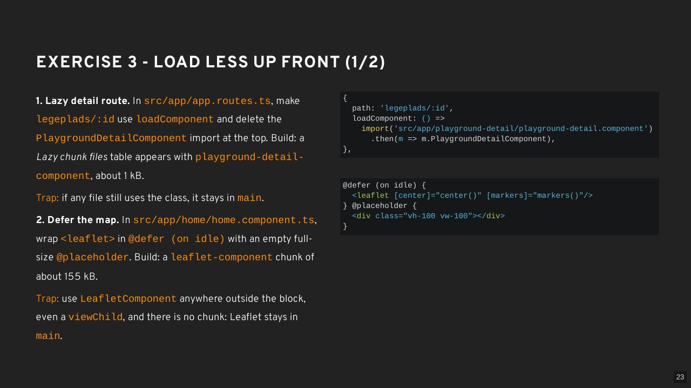

Speaker notes

> Change 1: app.routes.ts, loadComponent, delete the static import. Lazy table: playground-detail-component, about 1 kB.
> Change 2: home.component.ts, @defer (on idle) around leaflet, placeholder an empty vh-100 vw-100 div. Lazy table: leaflet-component, about 155 kB.
> Measured on a copy: viewChild(LeafletComponent) in Home on top of the defer = no leaflet chunk, 1.79 MB.
> Don't tell them which change wins.
>
> Two changes on this slide, build after each.
> One: the detail route. In app.routes.ts, replace component with loadComponent and an import(), and delete the import line at the top. Build, and a second table shows up: lazy chunk files, with playground-detail-component in it. About one kilobyte. Small, but the table is the proof it worked. If anything still uses the class the normal way, there's no chunk.
> Two: the map. In home.component.ts, wrap the leaflet element in @defer on idle, and give it a placeholder: an empty div with vh-100 vw-100, so the page doesn't jump. Build again: a leaflet-component chunk of about 155 kilobytes.
> The trap: if anything in Home touches LeafletComponent outside the block, a viewChild for example, it stays eager and you get no chunk at all. Look for the chunk in the lazy table every time.
> Ask the room after each build: did Initial total move as much as you expected?

## 24. Exercise 3 - Load less up front (2/2)

`exercise-3-load-less-2.html`

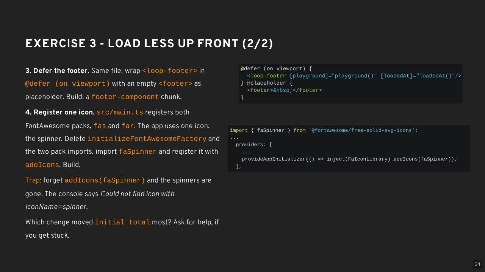

Speaker notes

> Change 3: @defer (on viewport) around loop-footer, placeholder <footer>&nbsp;</footer>. Lazy table: footer-component.
> Change 4: main.ts. Delete initializeFontAwesomeFactory and the fas/far imports; provideAppInitializer(() => inject(FaIconLibrary).addIcons(faSpinner)).
> Forget addIcons: no spinner, console "Could not find icon with iconName=spinner and prefix=fas in the icon library."
> Still don't say which wins. That's the next slide but one.
>
> Two more.
> Three: the footer. Same file, wrap loop-footer in @defer on viewport, and the placeholder is an empty footer with a non-breaking space so it keeps its height. Build: a footer-component chunk.
> Four: the icons. Open main.ts. The app registers every icon in two FontAwesome packs, solid and regular, through that initializeFontAwesomeFactory. Ask the room: how many icons does the app actually show? One. The spinner. So delete the factory and the two pack imports, import faSpinner, and in provideAppInitializer call addIcons with just that one.
> If you remove the packs and forget addIcons, the spinners disappear and the console tells you it can't find the spinner icon.
> Build, write the number down, and compare the four numbers you have. Which one moved it most?

## 25. Exercise 3 - Watch the chunks load

`exercise-3-see-it-load.html`

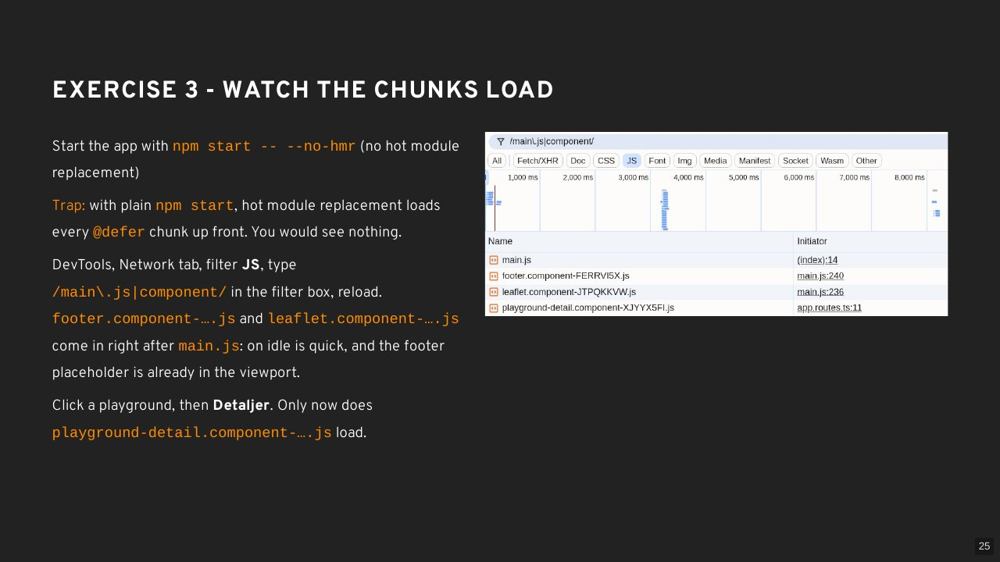

Speaker notes

> npm start -- --no-hmr. Network, filter JS, reload: footer.component and leaflet.component about 0.1 s after main. Detaljer: playground-detail.component loads on the click.
> Plain npm start (HMR) loads defer chunks up front: the most common "defer doesn't work" question.
>
> The build table told us the chunks exist. Now we watch them load.
> Stop the dev server and start it with npm start -- --no-hmr. Hot module replacement loads every defer chunk up front, so with plain npm start the Network tab shows nothing interesting and you'd think defer is broken.
> Network tab, filter on JS, reload. Right after main you see footer.component and leaflet.component. On idle fires fast on an idle laptop, and the footer's placeholder is on screen from the start, so on viewport fires at once too.
> Now click a playground and then Detaljer. Only then does playground-detail.component show up in the list. That's the lazy route.
> Ask the room: on a phone on a slow network, which of those would you rather have the user wait for?

## 26. Exercise 3 - What did you measure?

`exercise-3-what-we-measured.html`

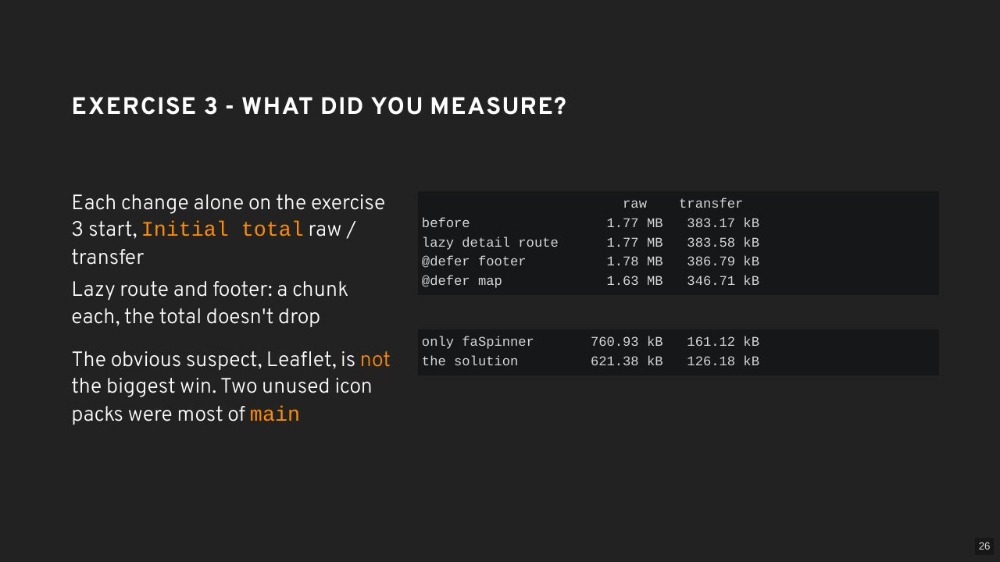

Speaker notes

> Show after the exercise, compare with the sticky-note guesses. Click once to reveal the icon row and the punchline.
> Each row is one change alone on a copy of the exercise 3 start (npm run build, 2026-10-30). Solution row = build of solution 3, bonus included.
> Their numbers are cumulative, so they differ: route 1.77 MB, + map 1.62 MB, + footer 1.64 MB, + icons 618 kB.
>
> Let's compare. I made each change alone on a copy of the starting point, so you can see what each one is worth.
> The lazy route: a one-kilobyte chunk, and Initial total doesn't move. The footer: same story, it even grows a little: splitting has a small cost of its own. Those two are about the pattern, not the bytes.
> The map: 1.77 down to 1.63 MB. Leaflet is the library everyone points at, and it's 155 kilobytes.
> Ask the room: who guessed the map? Hands up. Now click.
> Registering only the spinner: 1.77 MB down to 761 kilobytes, 383 down to 161 transferred. The biggest single win, and the change is two lines. Those two icon packs were most of main.
> Everything together, the solution: 621 kilobytes, 126 transferred.
> So: don't guess where the weight is. Read the build, change the biggest thing first, and measure again.

## 27. Exercise 3 - Bonus: Om appen

`exercise-3-bonus-about-panel.html`

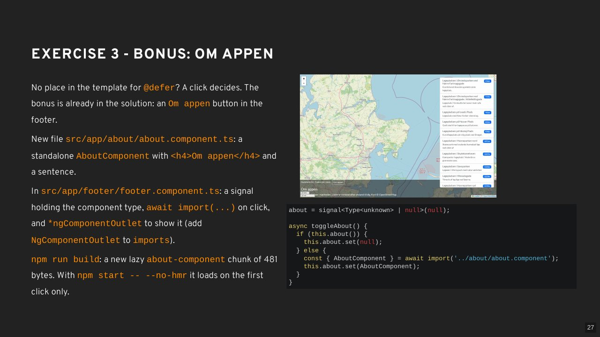

Speaker notes

> Already in solution 3 (labs/performance/exercise-4 has it). Lazy dynamic component: await import + NgComponentOutlet.
> Build: about-component 481 bytes in the lazy table. --no-hmr Network: about.component-….js on the first click, nothing on the next ones.
> Template: <ng-container *ngComponentOutlet="about()"/>. Alternative: ViewContainerRef.createComponent.
>
> For those who are done. Sometimes there's no place in a template for @defer: the user clicks a button, and only then do you know you need the component. Then you do it by hand.
> Step one: await import() gives you the file, and from it the component class. The bundler puts that file in its own chunk, so nothing is downloaded until that line runs.
> Step two: render it. NgComponentOutlet takes a component type and renders it, and with null it renders nothing. The signal holds the type, so it works zoneless too. The other way is createComponent on a ViewContainerRef; NgComponentOutlet is shorter.
> Build and you get a tiny lazy chunk, about-component, 481 bytes. In the browser with no HMR, open Network, click Om appen: one request. Close it and open it again: no new request.
> It's already in the solution, so if you didn't get to it, open the footer there.
> Ask the room: what in your app is behind a button that almost nobody clicks? A dialog, an export, a help panel?

## 28. Leaks in Angular apps

`leaks-in-angular-apps.html`

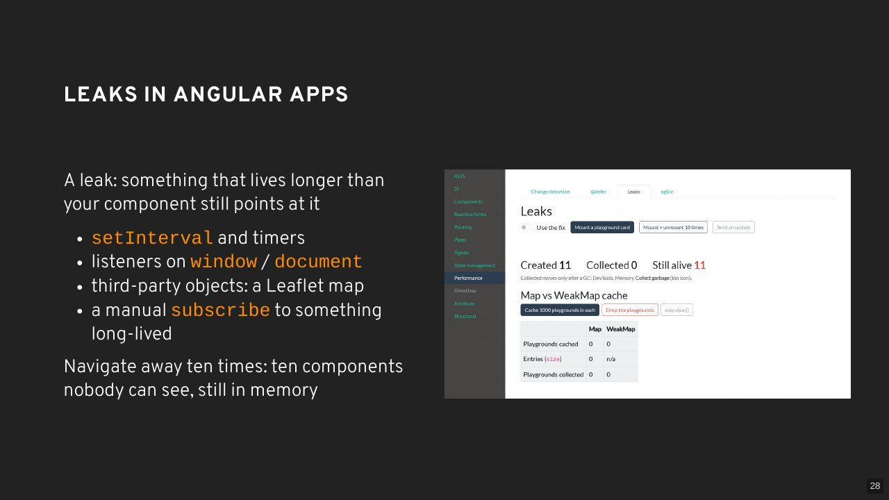

Speaker notes

> Demo: /performance/leaks. Mount a playground card, Unmount, Mount + unmount 10 times: Created 11, Still alive 11; Memory → Collect garbage: still 11. Reload, tick Use the fix, Mount + unmount 10 times, collect garbage: Created 10, Collected 10, Still alive 0.
> Click: ten components nobody can see.
>
> Garbage collection frees what nothing points to. A leak is when something that lives longer than your component still points at it. In a single page app the page lives for hours, so every navigation can add one more.
> The usual suspects. setInterval: the browser holds your callback, and the callback holds the component. Listeners you put on window or document yourself. Third-party objects like a Leaflet map, which adds its own listener on window. And a subscribe you made by hand to something that outlives the component.
> Let me show you. /performance/leaks. Mount a card, unmount it, then Mount + unmount 10 times. Created 11, Still alive 11. Open the Memory tab and click Collect garbage: still 11. Nothing lets go of them.
> Reload, tick Use the fix, same clicks, collect garbage: Created 10, Collected 10, Still alive 0.
> Click. That's the leak in one sentence: ten components nobody can see, still in memory.
> Ask the room: where in your own app do you call setInterval or addEventListener, and who stops it?
> Two of these suspects are in our app on purpose, the footer's interval and the map. That's exercise 4.

## 29. Cleaning up with DestroyRef

`cleaning-up-with-destroyref.html`

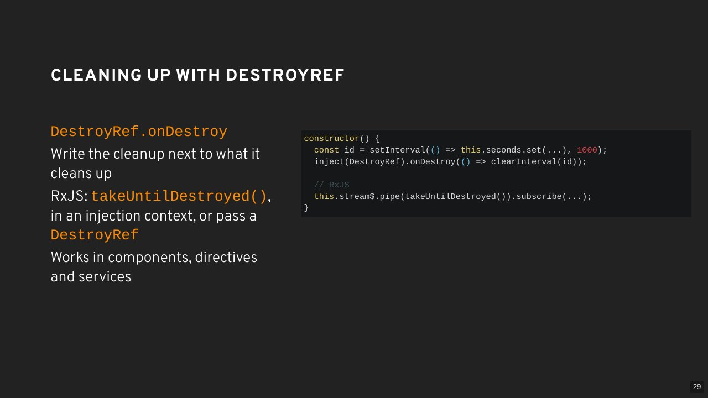

Speaker notes

> DestroyRef.onDestroy: run this when the owner (component, service, directive) is destroyed.
> Register next to where you create the thing.
> takeUntilDestroyed() for RxJS in an injection context; pass a DestroyRef elsewhere.
> The footer interval on the right is the fix from the exercise.
>
> DestroyRef is the one tool for cleanup. Inject it, and onDestroy takes a function that runs when the component, directive or service that owns it is destroyed.
> The big advantage over ngOnDestroy: you write the cleanup right next to the thing it cleans up, and you do not have to store the id in a field just to reach it later.
> Here is the footer from the exercise: setInterval gives an id, and the next line says: when this is destroyed, clearInterval that id.
> For RxJS there is takeUntilDestroyed. In a constructor or field initializer you call it with no argument; anywhere else, pass in the DestroyRef.
> In the exercise you do the same for the Leaflet map: after you create it, register a callback that calls remove on the map.

## 30. Heap snapshots

`heap-snapshots.html`

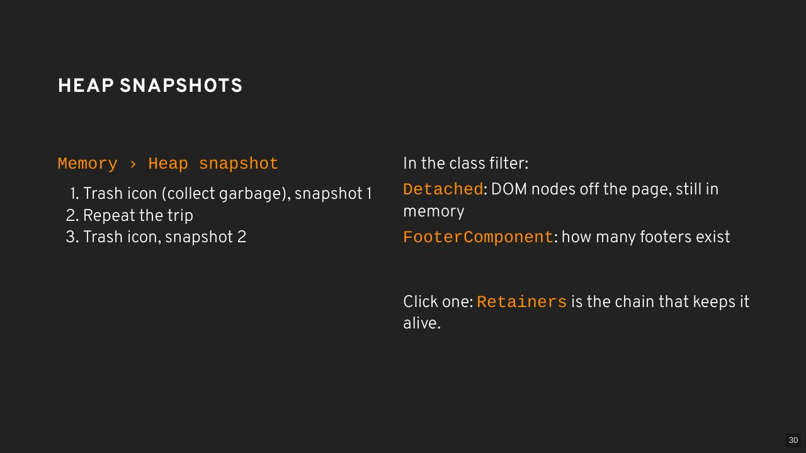

Speaker notes

> Memory tab, Heap snapshot. Trash icon before every snapshot.
> Filter Detached, then a class name. Click: Retainers is the chain that holds it.
>
> A heap snapshot is a photo of every object in memory. You take two around the same trip and compare.
> Open DevTools, Memory tab, Heap snapshot. Click the trash can first: that forces a garbage collection, so what's left is really being held. Take snapshot one. Do the trip a few times, trash can again, snapshot two.
> In the class filter type Detached. A detached node is a DOM node that's no longer in the page but still in memory, because something points at it. Then type a class name, like FooterComponent, and count. One footer on screen should be one FooterComponent in memory. Anything more is a leak.
> Click. Click one of them and look at the Retainers pane: it's the chain of references that keeps it alive. Follow it until you hit something you wrote, or a library you called. That's the pointer you need to cut.
> Retained size is what would be freed together with the object, so sort by it to find the big ones.
> Ask the room: has anyone opened the Memory tab on their own app? What did you find?

## 31. Exercise 4 - Find the leaks

`exercise-4-find-the-leaks.html`

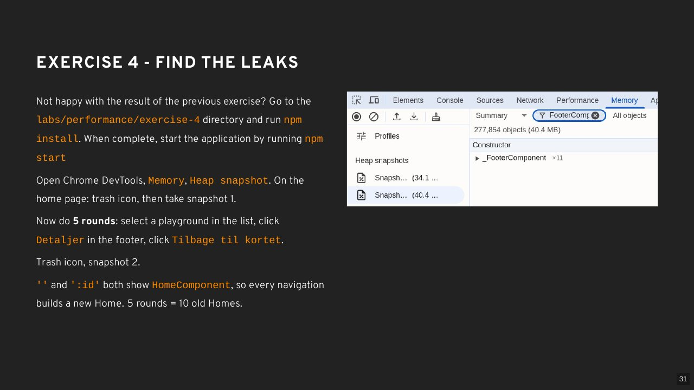

Speaker notes

> Lab: labs/performance/exercise-4, npm install, npm start.
> Snapshot 1 on home, 5 rounds (select, Detaljer, Tilbage til kortet), snapshot 2.
> One round builds Home twice: select navigates to /:id, back is a new Home. 5 rounds = 10.
>
> Last exercise, and this time we don't fix anything until we've measured. If you want a clean start, labs/performance/exercise-4, npm install, npm start.
> Open DevTools, Memory, Heap snapshot. On the home page, click the trash can and take snapshot one.
> Now five rounds. Select a playground in the list, click Detaljer in the footer, that's the detail page on the right, and click Tilbage til kortet. Five times. Trash can, snapshot two.
> Why do I insist on counting rounds? Because you'll count footers in a minute, and the number will surprise you if you don't know this: selecting a playground navigates to /:id, and that's a new Home. Coming back from the detail page is another new Home. Two per round. Five rounds, ten Homes that should be gone.
> Ask the room: how many FooterComponents do you expect in snapshot two?

## 32. Exercise 4 - Read the snapshot

`exercise-4-read-the-snapshot.html`

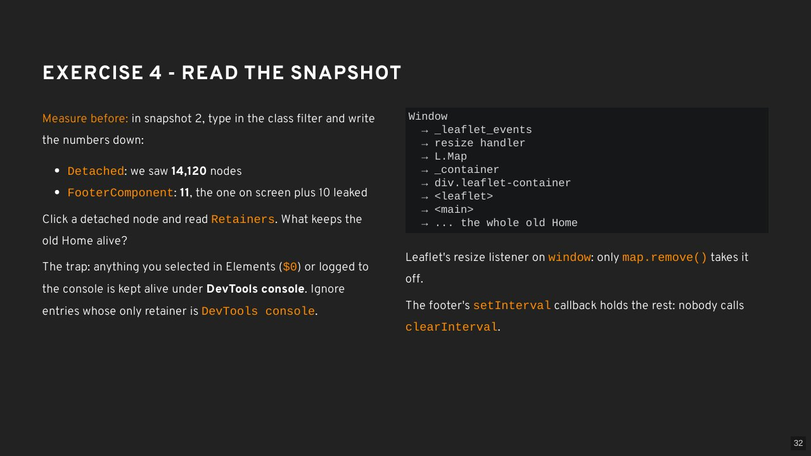

Speaker notes

> Before numbers after 5 rounds: Detached 14,120, FooterComponent 11 (1 live + 10 leaked).
> Retainers on a detached node: Window -> _leaflet_events -> resize handler -> L.Map -> ... -> <main>.
> Click: the two culprits. Trap: DevTools console retainers.
>
> In snapshot two, type Detached in the class filter. We saw 14,120 detached nodes. Your number will be close, but write down yours. Then FooterComponent: 11. One is the footer on screen, ten are leaked, two per round, like I said.
> Now click one of the detached nodes and read the Retainers pane. You'll see a chain like the one on the right: it starts at Window, goes through _leaflet_events, a resize handler, the Leaflet map, its container div, and from there up through the leaflet element and main into the whole old Home.
> Ask the room: who put a listener on window? Let them guess before you click.
> Click. Leaflet did. A map listens for window resize, and only map.remove() takes the listener off. Nobody calls it, so the map keeps its container, and a detached node keeps its parents, so the whole old Home stays. The footer is the other half: the setInterval callback still runs every second and holds the footer.
> The trap: if you click around in the Elements panel or log a node to the console, DevTools itself holds on to it, and it shows up with DevTools console as its retainer. That's not your app. Ignore those.

## 33. Exercise 4 - Fix the leaks

`exercise-4-fix-the-leaks.html`

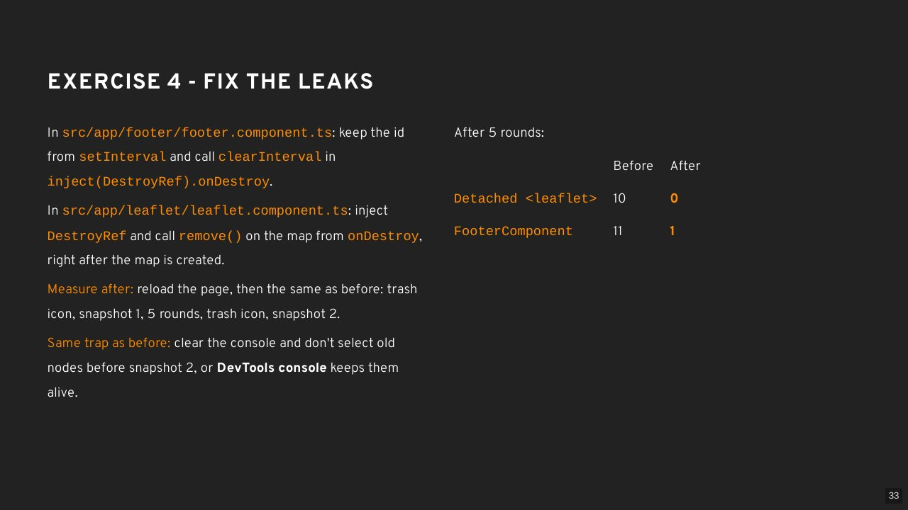

Speaker notes

> Two fixes, both DestroyRef.onDestroy: clearInterval in footer.component.ts, map.remove() in leaflet.component.ts.
> After 5 rounds: Detached 14,120 -> 0, FooterComponent 11 -> 1. Trap: clear the console, don't select old nodes.
>
> Two leaks, two fixes, both with DestroyRef, like on the slide a moment ago.
> In footer.component.ts: keep the id that setInterval returns, and register inject(DestroyRef).onDestroy with a clearInterval of that id.
> In leaflet.component.ts: inject DestroyRef too, and right after the map is created, register a callback that calls remove on the map. The ngOnDestroy that unsubscribes can stay.
> Then reload and measure exactly the same way: trash can, snapshot one, five rounds, trash can, snapshot two.
> You should see Detached go from about 14,000 to 0, and one FooterComponent, the one on screen.
> The trap from the last slide bites hardest here: clear the console and don't select old nodes before snapshot two, or DevTools console keeps them alive and your after number lies.
> The intervals row: we counted those with a small wrapper, you don't have to. After the fix there are two in a dev build: the footer's and one the dev build starts itself. A production build has just one.
> Ask the room: if you still see FooterComponents growing, what would you read next? The Retainers pane, again.

## 34. Exercise 4 - Bonus: content-visibility

`exercise-4-bonus-content-visibility.html`

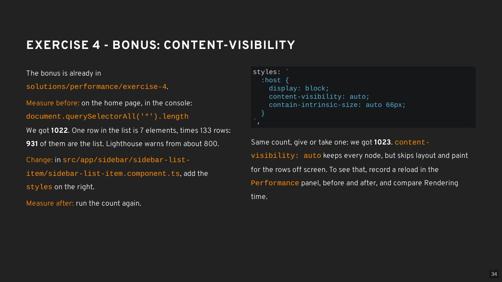

Speaker notes

> Already in the solution. Count: 1022 on home, 931 of them the list (7 x 133).
> Click: count unchanged. It saves render work, not nodes.
>
> The bonus is already in the solution, so if you're short on time, open solutions/performance/exercise-4 and read it.
> First measure. On the home page, run document.querySelectorAll star dot length in the console. We got 1022. Where do they come from? Open one row in the Elements panel: the list item, a button, a div, an h6, a small, another div and a span. Seven, times 133 playgrounds, 931. The list is almost the whole page, and Lighthouse already warns from about 800.
> Then the change: a styles block on the list item's host, the one on the right. content-visibility auto, and contain-intrinsic-size so the scrollbar doesn't jump while rows are skipped.
> Ask the room: what will the count be after the change?
> Click. The same, 1023 against 1022. content-visibility doesn't remove a single node. It tells the browser not to lay out or paint rows that are off screen. If you want to see that, record a reload in the Performance panel before and after and compare the Rendering time; a CPU slowdown makes the difference easier to see.
> Fewer nodes would be a different fix: fewer elements per row, or virtual scroll.

## 35. The fixes of the day

`wrap-the-fixes-of-the-day.html`

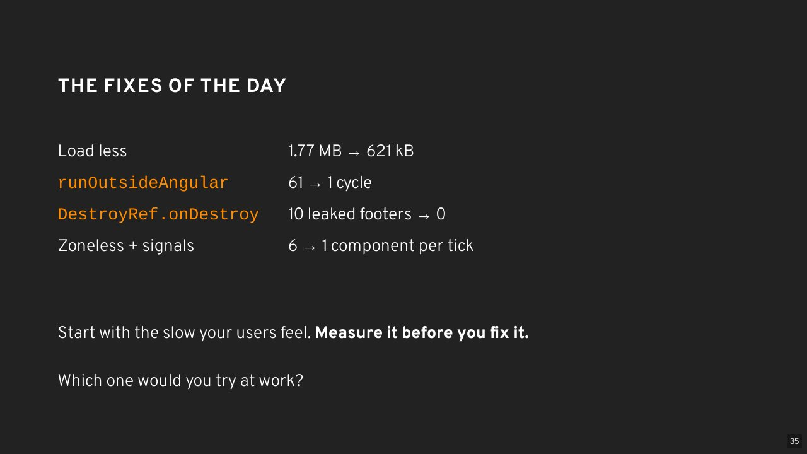

Speaker notes

> Four fixes, in the order they paid off in THIS app. Yours will differ: measure.
> Read the Monday line out.
> Click: the question to the room.
>
> Here's the day on one slide, in the order they paid off in our app.
> One: load less. Our first download was 1.77 megabytes, and the biggest part wasn't the map, it was an icon library we registered in full. Only the icons we use, a lazy route with loadComponent and two defer blocks, and Initial total in the build output was 621 kilobytes. Every user pays that on every load, so it goes first.
> Two: the map's mouse events ran change detection for the whole app. 60 mouse moves, 61 Profiler bars. One runOutsideAngular, and it was 1.
> Three: every visit left a footer and a map behind. After five rounds that was 10 footers and 14,000 detached nodes in the heap snapshot. Two onDestroy callbacks, and it was 0. Small per visit, but it grows for as long as the tab is open.
> Four: zoneless and signals. Here the honest number is smaller: when the footer ticks, the Profiler shows Angular refreshing the footer instead of all six components. A click in the list still refreshes everything once. It pays more the bigger your component tree is.
> So on Monday: in your own app, start with the kind of slow your users complain about, not with the fix you liked best today. Measure that first: Initial total from the build, bars in the Profiler, or instances across two heap snapshots. Write the number down, change one thing, measure again.
> Click. Ask the room: which one would you try at work, and what would you measure first? Let two or three people answer.

## 36. Time for questions🤓

`time-for-questions.html`

Speaker notes

> Questions. If it's quiet, ask the Monday question.
>
> Any questions about today, or about your own app? If it's quiet, ask the room: what will you measure first in your own app on Monday? Build size, Profiler bars or a heap snapshot? Let one or two people say why.

